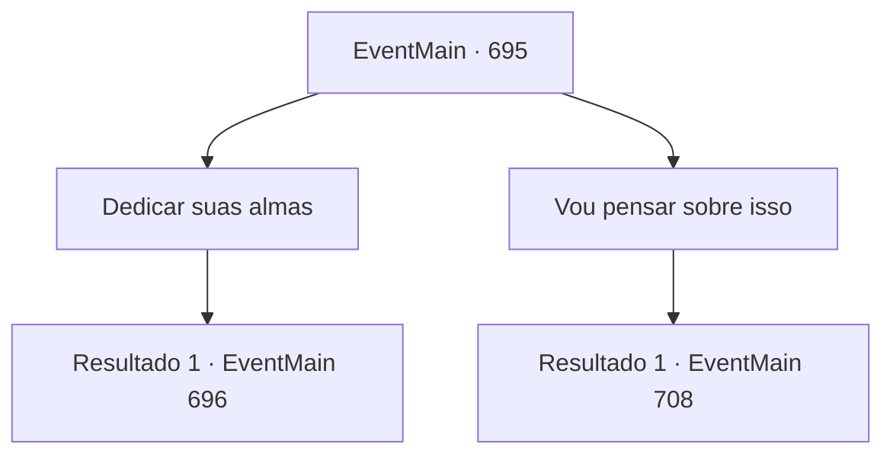

# Eventos principais · 695

[Índice da tabela](index.md) · [Índice geral](../index.md)

ID: `pt:EventMain:695` · Fonte: `EventMain4` · Versão: 1.2.47.

Mapeamento estático dos arquivos; a disponibilidade e a execução dependem do estado da run.

## Texto do evento

*Sem texto no arquivo.*

## Dados de entrada

```json
{
  "id": 695,
  "grade": 1,
  "normalGoal": "",
  "required": ""
}
```

## Mapa das escolhas



## Escolhas e resultados

### Escolha 1

Dedicar suas almas

Requisitos e outros campos da escolha:

```json
{
  "required": ""
}
```

#### Resultado 1.1

Você obedece a ele. Então você sai do sótão e faz o primeiro sacrifício da mulher que lhe deu o quarto. 

 "Tossindo! P..Por que..."

 A mulher morre com os olhos assustados. Você sacrifica até mesmo sua família gritando.

 Algumas horas depois, depois de matar todos os aldeões no campo, você respira fundo e olha ao redor. A vila está manchada de sangue, e alguns prédios estão queimando com uma fumaça preta e acre. 

 "Ótimo trabalho, {1}. Mas mais é necessário para lidar com os paladinos de Tere. Reúna mais, mais oferendas."

 A pedido de Kior, você suspira e deixa a vila.

Continuação registrada: [Evento 696](0696.md) na mesma tabela.

```json
{
  "required": "",
  "chance": "1",
  "nextEvent": 696,
  "type": 2,
  "reward": "0_3_-10"
}
```

### Escolha 2

Vou pensar sobre isso

Requisitos e outros campos da escolha:

```json
{
  "required": ""
}
```

#### Resultado 2.1

Você evita responder, dizendo que vai pensar sobre isso. Então Kior resmunga como se estivesse irritado e fecha a boca. Seu silêncio continua até você adormecer.

 Depois de sair da casa da mulher no dia seguinte, você caminha ao longo do caminho da montanha e chama Kior. Mas ele não responde. 

 "Finalmente, te encontrei! {1}!"

 Nesse momento, de repente, os paladinos surgem das moitas e se aproximam de você. O primeiro deles é o Viyork que você conhece bem. Você rapidamente puxa sua arma.

Continuação registrada: [Evento 708](0708.md) na mesma tabela.

```json
{
  "required": "",
  "chance": "1",
  "nextEvent": 708,
  "type": 2,
  "reward": "6_0_147",
  "place": 1
}
```

## Referências que chegam a este evento

- [Evento 694 · escolha 1 · resultado 1](0694.md#escolha-1)
