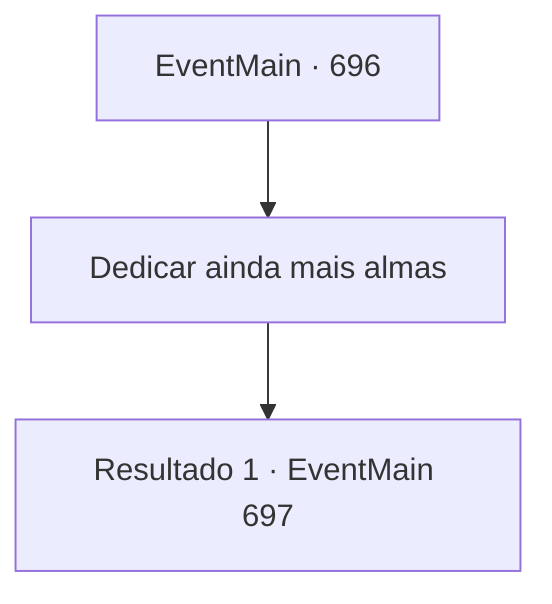

# Eventos principais · 696

[Índice da tabela](index.md) · [Índice geral](../index.md)

ID: `pt:EventMain:696` · Fonte: `EventMain4` · Versão: 1.2.47.

Mapeamento estático dos arquivos; a disponibilidade e a execução dependem do estado da run.

## Texto do evento

*Sem texto no arquivo.*

## Dados de entrada

```json
{
  "id": 696,
  "grade": 1,
  "normalGoal": "",
  "required": ""
}
```

## Mapa das escolhas



## Escolhas e resultados

### Escolha 1

Dedicar ainda mais almas

Requisitos e outros campos da escolha:

```json
{
  "required": ""
}
```

#### Resultado 1.1

Saindo do campo, você ataca outras aldeias próximas também. Não há exceções para os agricultores arando os campos, mulheres lavando roupas ou crianças correndo por aí. Você os sacrifica todos. Toda vez que isso acontece, seu corpo é manchado de sangue e uma estranha vitalidade surge. Antes que você perceba, suas costas têm braços escuros feitos de mana de Kior. 

 "Vá para a próxima aldeia."

 Você ataca a quinta cidade conforme ordenado por Kior. Então, os paladinos de Tere aparecem e ficam em seu caminho. A paladina mulher, Valen, de cabelos vermelhos, os lidera. 

 "Isso é terrível. É obra do demônio."

 Franzindo a testa, ela corre em sua direção, empunhando sua espada como um relâmpago.

Continuação registrada: [Evento 697](0697.md) na mesma tabela.

```json
{
  "required": "",
  "chance": "1",
  "nextEvent": 697,
  "type": 2,
  "reward": "0_3_-10|0_5_1|0_6_1|0_12_1|0_14_-1|6_3_148",
  "place": 4
}
```

## Referências que chegam a este evento

- [Evento 695 · escolha 1 · resultado 1](0695.md#escolha-1)
