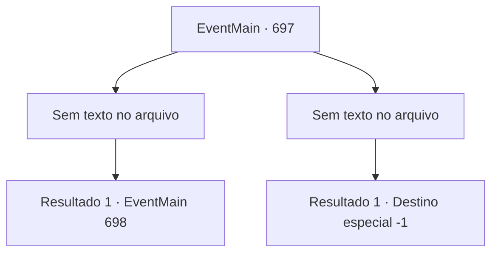

# Eventos principais · 697

[Índice da tabela](index.md) · [Índice geral](../index.md)

ID: `pt:EventMain:697` · Fonte: `EventMain4` · Versão: 1.2.47.

Mapeamento estático dos arquivos; a disponibilidade e a execução dependem do estado da run.

## Texto do evento

*Sem texto no arquivo.*

## Dados de entrada

```json
{
  "id": 697,
  "grade": 1,
  "normalGoal": "",
  "required": ""
}
```

## Mapa das escolhas



## Escolhas e resultados

### Escolha 1

*Sem texto no arquivo; o papel dessa opção depende da interface do jogo.*

Requisitos e outros campos da escolha:

```json
{
  "required": ""
}
```

#### Resultado 1.1

A espada de Valen está despedaçada e espalhada. Imediatamente depois disso, você agarra Valen com seus braços sombrios. E você agarra a cabeça dela imediatamente e retira sua alma. 

 "Arg..! Ahhhhh!"

 Na cena chocante, os paladinos próximos ficam congelados no lugar. Num instante, o corpo de Valen perde sua alma e desaba como uma marionete quebrada. Logo em seguida, o mana sombrio de Kior flui para ela e cobre todo o seu corpo. E Valen se levanta novamente. Seus olhos estão negros, e lama negra está fluindo de seu corpo. Novamente, Valen salta instantaneamente sobre os paladinos e os transforma em cadáveres ensanguentados. 

 "Oh meu Deus..!"

 "Fujam, todos!"

 Os Paladinos de Tere fogem em pânico. Enquanto você os observa, a voz de Kior é ouvida. 

 "O que você acha? Você pode honestamente admirar minha habilidade."


Continuação registrada: [Evento 698](0698.md) na mesma tabela.

```json
{
  "required": "",
  "chance": "1",
  "nextEvent": 698,
  "type": 2,
  "reward": "0_5_-1|0_6_-1|0_12_-1"
}
```

### Escolha 2

*Sem texto no arquivo; o papel dessa opção depende da interface do jogo.*

Requisitos e outros campos da escolha:

```json
{
  "required": ""
}
```

#### Resultado 2.1

Você acaba ajoelhado(a) na frente de Valen. Ela se aproxima de você com o rosto frio e chuta seu queixo com força. O choque faz com que você não consiga mais controlar seu corpo. 

 "Não pense que pode morrer facilmente. Você nem será capaz de morrer até pagar por todos os seus pecados."

 Sua voz é ouvida através da consciência que está desaparecendo.

Continuação registrada: [Destino especial `-1`](../destinos-especiais.md).

```json
{
  "required": "",
  "chance": "1",
  "nextEvent": -1,
  "type": 2,
  "reward": "15_5_2|15_5_13"
}
```

## Referências que chegam a este evento

- [Evento 696 · escolha 1 · resultado 1](0696.md#escolha-1)
