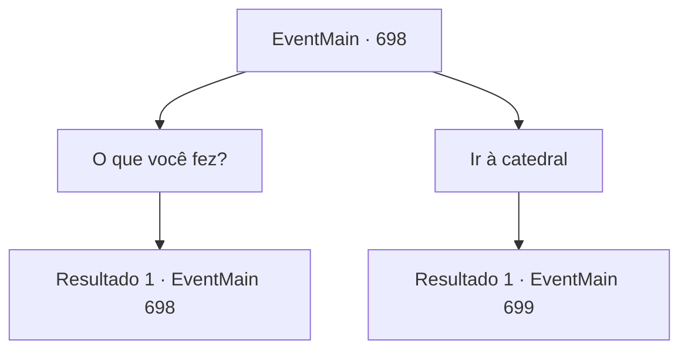

# Eventos principais · 698

[Índice da tabela](index.md) · [Índice geral](../index.md)

ID: `pt:EventMain:698` · Fonte: `EventMain4` · Versão: 1.2.47.

Mapeamento estático dos arquivos; a disponibilidade e a execução dependem do estado da run.

## Texto do evento

*Sem texto no arquivo.*

## Dados de entrada

```json
{
  "id": 698,
  "grade": 1,
  "normalGoal": "",
  "required": ""
}
```

## Mapa das escolhas



## Escolhas e resultados

### Escolha 1

O que você fez?

Requisitos e outros campos da escolha:

```json
{
  "required": "5_408_0"
}
```

#### Resultado 1.1

Kior responde à sua pergunta com um sorriso. 

 "Obrigado pelo seu sacrifício. {1}. A maior parte da mana foi usada, mas pode corromper sua alma e deixar seu corpo mais bonito."

 Como ele disse, você pode ver que o poder que antes estava cheio no corpo diminuiu. Kior muda de assunto, dizendo que há algo importante. Enquanto transformava Valen em um morto-vivo, ele extraiu informações de sua memória. Kior diz que a maioria dos paladinos de Tere está procurando por você, e Publius está na 'Catedral de Yerut'. 

 "É uma boa oportunidade para matar Publius. Se a maioria dos paladinos estiver fora, será fácil matá-lo. Agora, vá para a catedral."


Continuação registrada: [Evento 698](0698.md) na mesma tabela.

```json
{
  "required": "",
  "chance": "1",
  "nextEvent": 698,
  "type": 2,
  "reward": "5_408_1"
}
```

### Escolha 2

Ir à catedral

Requisitos e outros campos da escolha:

```json
{
  "required": "5_408_1"
}
```

#### Resultado 2.1

Você segue as palavras de Kior e segue para a catedral. Valen, que se tornou um morto-vivo, mergulha na sua sombra.

 No caminho para a catedral, há um lugar chamado 'Caminho da Adoração'. Dizem que Tere abençoou um grande herói, e também é o caminho que os sacerdotes de Teretian devem seguir quando partem para a missão. Quando você entra lá, um homem te impede. Ele é um homem que você nunca esquecerá, com escamas douradas e olhos rasgados verticalmente. O paladino Lizardfolk, Onil, saca sua espada e fala em voz baixa. 

 "Demônio! Enquanto eu estiver guardando, você não ousará ir para a catedral!"


Continuação registrada: [Evento 699](0699.md) na mesma tabela.

```json
{
  "required": "",
  "chance": "1",
  "nextEvent": 699,
  "type": 2,
  "reward": ""
}
```

## Referências que chegam a este evento

- [Evento 697 · escolha 1 · resultado 1](0697.md#escolha-1)
- [Evento 698 · escolha 1 · resultado 1](0698.md#escolha-1)
