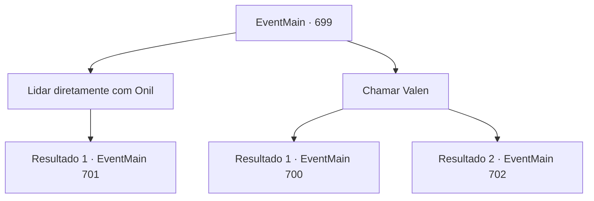

# Eventos principais · 699

[Índice da tabela](index.md) · [Índice geral](../index.md)

ID: `pt:EventMain:699` · Fonte: `EventMain4` · Versão: 1.2.47.

Mapeamento estático dos arquivos; a disponibilidade e a execução dependem do estado da run.

## Texto do evento

*Sem texto no arquivo.*

## Dados de entrada

```json
{
  "id": 699,
  "grade": 1,
  "normalGoal": "",
  "required": ""
}
```

## Mapa das escolhas



## Escolhas e resultados

### Escolha 1

Lidar diretamente com Onil

Requisitos e outros campos da escolha:

```json
{
  "required": ""
}
```

#### Resultado 1.1

Você decide lidar com ele pessoalmente e avança em direção a ele num piscar de olhos. Então Onil ergue sua espada e grita. 

 "Ataquem todos! Não enviarei mais daqui!"

 Outros paladinos que estavam escondidos em seu grito surgem e te cercam. E brande a espada em sua direção junto com Onil.

Continuação registrada: [Evento 701](0701.md) na mesma tabela.

```json
{
  "required": "",
  "chance": "1",
  "nextEvent": 701,
  "type": 2,
  "reward": "6_3_145",
  "place": 0
}
```

### Escolha 2

Chamar Valen

Requisitos e outros campos da escolha:

```json
{
  "required": ""
}
```

#### Resultado 2.1

Você chama Valen em vez de lutar pessoalmente. Onil abre os olhos quando vê Valen saindo das sombras. 

 "Valen, como... você... Isso... esse demônio...! Como se atreve!!"

 Onil ergue suas escamas e balança sua espada em direção a Valen sem hesitar, Você injeta mana no corpo de Valen. Após dezenas de ataques, a espada de Valen está prestes a cortar a garganta de Onil. 

 "Protejam o Senhor Onil!"

 Paladinos escondidos surgem e bloqueiam Valen. Você se junta à luta para evitar que Valen seja cercado.

Continuação registrada: [Evento 700](0700.md) na mesma tabela.

```json
{
  "required": "",
  "chance": "1|0_12_1",
  "nextEvent": 700,
  "type": 0,
  "reward": "6_3_50",
  "place": 0
}
```

#### Resultado 2.2

Você chama Valen em vez de lutar pessoalmente. Onil abre os olhos quando vê Valen saindo das sombras. 

 "Valen, como... você... Esse... esse demônio...! Como se atreve!!"

 Onil ergue suas escamas e agita sua espada em direção a Valen sem hesitar, Você injeta mana no corpo de Valen. Após dezenas de ataques, o duelo termina com a espada de Onil cortando o corpo de Valen ao meio. Onil, coberto de sangue negro, grita para você, apontando a espada. Sua voz e mãos tremem de raiva. 

 "É a sua vez... Não é suficiente matar Valen, mas humilhar o corpo! Farei você pagar por seus pecados!!!"

 Ele está cansado de enfrentar Valen, mas mesmo assim exala um clima ameaçador. E quando ele grita, os cavaleiros escondidos aparecem e te cercam.

Continuação registrada: [Evento 702](0702.md) na mesma tabela.

```json
{
  "required": "",
  "chance": "30",
  "nextEvent": 702,
  "type": 1,
  "reward": "6_0_145",
  "place": 0
}
```

## Referências que chegam a este evento

- [Evento 698 · escolha 2 · resultado 1](0698.md#escolha-2)
