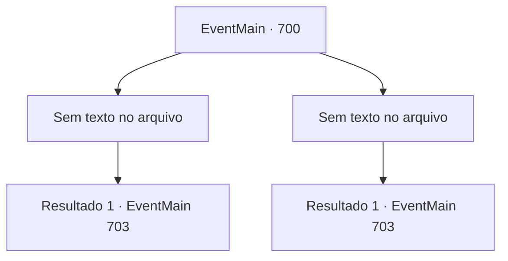

# Eventos principais · 700

[Índice da tabela](index.md) · [Índice geral](../index.md)

ID: `pt:EventMain:700` · Fonte: `EventMain4` · Versão: 1.2.47.

Mapeamento estático dos arquivos; a disponibilidade e a execução dependem do estado da run.

## Texto do evento

*Sem texto no arquivo.*

## Dados de entrada

```json
{
  "id": 700,
  "grade": 1,
  "normalGoal": "",
  "required": ""
}
```

## Mapa das escolhas



## Escolhas e resultados

### Escolha 1

*Sem texto no arquivo; o papel dessa opção depende da interface do jogo.*

Requisitos e outros campos da escolha:

```json
{
  "required": ""
}
```

#### Resultado 1.1

Você se livra de todos os paladinos. Enquanto isso, Valen parece ter esfaqueado Onil no coração. 

 "A... Ah..."

 Onil tenta dizer algo, mas apenas o som de um vazamento sai. O corpo sangrando de Onil se ajoelha. Você se aproxima dele, agarra sua cabeça e suga sua alma. |drawing_drain| À medida que sua alma começa a ser levada embora, Onil treme por todo o corpo, incapaz de suportar a dor. 

 "Khuuuk...!! Ofegante!!!"

 Eventualmente, Onil morre com toda a sua alma levada embora. Você deixa o casulo vazio de Onil e se apressa em direção à Catedral de Yerut.

Continuação registrada: [Evento 703](0703.md) na mesma tabela.

```json
{
  "required": "",
  "chance": "1",
  "nextEvent": 703,
  "type": 2,
  "reward": "5_409_1|3_249_1"
}
```

### Escolha 2

*Sem texto no arquivo; o papel dessa opção depende da interface do jogo.*

Requisitos e outros campos da escolha:

```json
{
  "required": ""
}
```

#### Resultado 2.1

No momento em que você está em crise devido ao ataque dos paladinos, Valen bloqueia a espada voadora. E seu corpo se desfaz em cinzas. Você, que salva a vida com o sacrifício de Valen, aproveita essa oportunidade para contra-atacar. Todos os paladinos que perdem a chance de te matar acabam morrendo. Você recupera o fôlego por um momento e olha para Onil. |drawing_drain| Onil, que estava gravemente ferido, morreu enquanto você estava lutando. Você se aproxima dele, segura sua cabeça e suga sua alma. E você deixa o corpo vazio de Onil e se apressa em direção à Catedral de Yerut.

Continuação registrada: [Evento 703](0703.md) na mesma tabela.

```json
{
  "required": "",
  "chance": "1",
  "nextEvent": 703,
  "type": 2,
  "reward": "3_249_1"
}
```

## Referências que chegam a este evento

- [Evento 699 · escolha 2 · resultado 1](0699.md#escolha-2)
