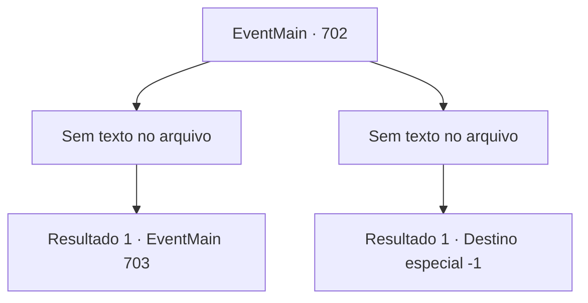

# Eventos principais · 702

[Índice da tabela](index.md) · [Índice geral](../index.md)

ID: `pt:EventMain:702` · Fonte: `EventMain4` · Versão: 1.2.47.

Mapeamento estático dos arquivos; a disponibilidade e a execução dependem do estado da run.

## Texto do evento

*Sem texto no arquivo.*

## Dados de entrada

```json
{
  "id": 702,
  "grade": 1,
  "normalGoal": "",
  "required": ""
}
```

## Mapa das escolhas



## Escolhas e resultados

### Escolha 1

*Sem texto no arquivo; o papel dessa opção depende da interface do jogo.*

Requisitos e outros campos da escolha:

```json
{
  "required": ""
}
```

#### Resultado 1.1

Todos os paladinos que vieram até você caem sobre você. Você tira todas as suas almas e se aproxima de Onil, que está ofegante. Onil cospe sangue e solta um suspiro áspero. 

 "Ah... Haha... Eu entendo. Você está..."

 Somente então, aparentemente reconhecendo você, ele solta uma risada amarga e abaixa a cabeça. 

 "Você está vivo?... Com certeza... você está morto..."

 Você se aproxima dele murmurando e agarra sua cabeça. E assim como está, você suga sua alma através da sua mão. |drawing_drain| 

 "Khuuuk...!! Ofegante!!!"

 Eventualmente, Onil morre com toda a sua alma levada embora. Você deixa o casco vazio de Onil e se apressa em direção à Catedral de Yerut.

Continuação registrada: [Evento 703](0703.md) na mesma tabela.

```json
{
  "required": "",
  "chance": "1",
  "nextEvent": 703,
  "type": 2,
  "reward": "3_249_1"
}
```

### Escolha 2

*Sem texto no arquivo; o papel dessa opção depende da interface do jogo.*

Requisitos e outros campos da escolha:

```json
{
  "required": ""
}
```

#### Resultado 2.1


 "... É o fim."

 Apunhalado pela espada de Onil no coração, você vomita sangue. Através da consciência que se desvanece, a voz decepcionada de Kior é ouvida. 

 "Isso é patético..."

 Você pede por outra chance, mas sua voz não sai. Finalmente, sua consciência cai na escuridão.

Continuação registrada: [Destino especial `-1`](../destinos-especiais.md).

```json
{
  "required": "",
  "chance": "1",
  "nextEvent": -1,
  "type": 2,
  "reward": "15_5_13"
}
```

## Referências que chegam a este evento

- [Evento 699 · escolha 2 · resultado 2](0699.md#escolha-2)
