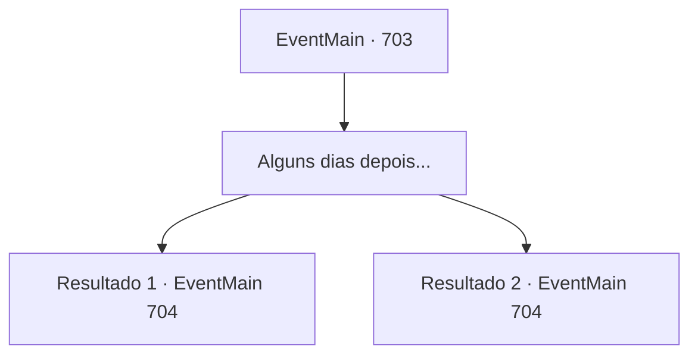

# Eventos principais · 703

[Índice da tabela](index.md) · [Índice geral](../index.md)

ID: `pt:EventMain:703` · Fonte: `EventMain4` · Versão: 1.2.47.

Mapeamento estático dos arquivos; a disponibilidade e a execução dependem do estado da run.

## Texto do evento

*Sem texto no arquivo.*

## Dados de entrada

```json
{
  "id": 703,
  "grade": 1,
  "normalGoal": "",
  "required": ""
}
```

## Mapa das escolhas



## Escolhas e resultados

### Escolha 1

Alguns dias depois...

Requisitos e outros campos da escolha:

```json
{
  "required": ""
}
```

#### Resultado 1.1

|drawing_tereCathedral| Alguns dias depois, a Catedral de Yerut, que chegou, é um lugar esplêndido. Todo o edifício é feito de mármore, com uma cúpula azul no topo. Por toda a parede externa há esculturas e pinturas em mosaico em homenagem aos santos de Teretian. 

 "Finalmente, que chega até aqui."

 Enquanto você está em frente à catedral, Publius aparece, liderando os paladinos. Os paladinos são poucos em número, mas estão cercados por uma luz brilhante. 

 "Todos! Matem o demônio!"

 Eles, cercados pela luz, avançam em sua direção com o grito de Publius. Você rapidamente saca sua arma, chama Valen e entra na luta.

Continuação registrada: [Evento 704](0704.md) na mesma tabela.

```json
{
  "required": "5_409_1",
  "chance": "1",
  "nextEvent": 704,
  "type": 2,
  "reward": "6_2_149",
  "place": 4
}
```

#### Resultado 1.2

|drawing_tereCathedral| Alguns dias depois, a Catedral de Yerut, que chegou, é um lugar esplêndido. Todo o edifício é feito de mármore, com uma cúpula azul no topo. Por toda a parede externa há esculturas e pinturas em mosaico em homenagem aos santos de Teretian. 

 "Finalmente, que chega até aqui."

 Enquanto você está em frente à catedral, Publius aparece, liderando os paladinos. Os paladinos são poucos em número, mas estão cercados por uma luz brilhante. 

 "Todos! Matem o demônio!"

 Eles, cercados pela luz, avançam em sua direção com o grito de Publius. Você rapidamente saca sua arma e entra na luta.

Continuação registrada: [Evento 704](0704.md) na mesma tabela.

```json
{
  "required": "18_409_1",
  "chance": "1",
  "nextEvent": 704,
  "type": 2,
  "reward": "6_0_149",
  "place": 4
}
```

## Referências que chegam a este evento

- [Evento 700 · escolha 1 · resultado 1](0700.md#escolha-1)
- [Evento 700 · escolha 2 · resultado 1](0700.md#escolha-2)
- [Evento 701 · escolha 1 · resultado 1](0701.md#escolha-1)
- [Evento 701 · escolha 2 · resultado 1](0701.md#escolha-2)
- [Evento 702 · escolha 1 · resultado 1](0702.md#escolha-1)
