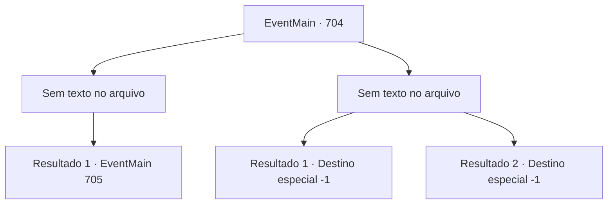

# Eventos principais · 704

[Índice da tabela](index.md) · [Índice geral](../index.md)

ID: `pt:EventMain:704` · Fonte: `EventMain4` · Versão: 1.2.47.

Mapeamento estático dos arquivos; a disponibilidade e a execução dependem do estado da run.

## Texto do evento

*Sem texto no arquivo.*

## Dados de entrada

```json
{
  "id": 704,
  "grade": 1,
  "normalGoal": "",
  "required": ""
}
```

## Mapa das escolhas



## Escolhas e resultados

### Escolha 1

*Sem texto no arquivo; o papel dessa opção depende da interface do jogo.*

Requisitos e outros campos da escolha:

```json
{
  "required": ""
}
```

#### Resultado 1.1

Os braços sombrios extinguem a luz que envolve os paladinos e lhes dão a morte. Cada vez que você faz isso, sente um prazer vertiginoso, e sua energia transborda como um vulcão ativo. Mesmo os paladinos com o poder da luz não conseguem te vencer. E quando você estende os braços novamente, 

 "Poderoso Tere! por favor, abra a porta para expulsar o mal!"

 Há um grito alto vindo de Publius. Naquele momento, o espaço se distorce, e uma força poderosa te atrai. E há uma voz assustada vinda de Kior. 

 "Desaparecimento... Parece que ele está tentando te jogar para outra dimensão. Segure-se em qualquer coisa!"

 Seu corpo começa a subir como se estivesse no meio de uma tempestade.

Continuação registrada: [Evento 705](0705.md) na mesma tabela.

```json
{
  "required": "",
  "chance": "1",
  "nextEvent": 705,
  "type": 2,
  "reward": ""
}
```

### Escolha 2

*Sem texto no arquivo; o papel dessa opção depende da interface do jogo.*

Requisitos e outros campos da escolha:

```json
{
  "required": ""
}
```

#### Resultado 2.1

No momento de crise, você chama Valen. E a usa como escudo para tentar escapar. Mas seu plano falha. Antes que Valen te proteja, a luz de Publius a alcança. O corpo de Valen, tocado pela luz, se desfaz como poeira. 

 "Fim ao demônio!!"

 Você se levanta cambaleando, e os paladinos avançam com a luz. Não há mais poder para detê-los, então você não tem escolha a não ser enfrentar o fim. Com o som de algo se quebrando, sua consciência se vai. E então, você ouve a voz decepcionada de Kior. 

 "Então chegamos a isso... patético..."

 Você tenta pedir por outra chance, mas nenhum som sai. Com isso, sua consciência afunda na escuridão.

Continuação registrada: [Destino especial `-1`](../destinos-especiais.md).

```json
{
  "required": "5_409_1",
  "chance": "1",
  "nextEvent": -1,
  "type": 2,
  "reward": "0_0_-1|0_1_-1|15_5_13|15_5_17"
}
```

#### Resultado 2.2


 "Fim ao demônio!!"

 Você se levanta cambaleando, e os paladinos avançam com a luz. Não há mais poder para detê-los, então você não tem escolha a não ser enfrentar o fim. Com o som de algo se quebrando, sua consciência se vai. E então, você ouve a voz decepcionada de Kior. 

 "Então chegamos a isso... patético...."

 Você tenta pedir por outra chance, mas nenhum som sai. Com isso, sua consciência afunda na escuridão.

Continuação registrada: [Destino especial `-1`](../destinos-especiais.md).

```json
{
  "required": "18_409_1",
  "chance": "1",
  "nextEvent": -1,
  "type": 2,
  "reward": "0_0_-1|0_1_-1|15_5_13|15_5_17"
}
```

## Referências que chegam a este evento

- [Evento 703 · escolha 1 · resultado 1](0703.md#escolha-1)
- [Evento 703 · escolha 1 · resultado 2](0703.md#escolha-1)
