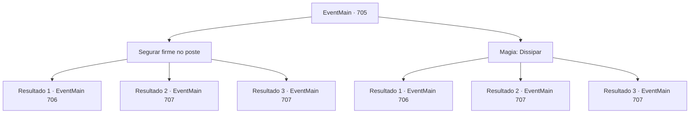

# Eventos principais · 705

[Índice da tabela](index.md) · [Índice geral](../index.md)

ID: `pt:EventMain:705` · Fonte: `EventMain4` · Versão: 1.2.47.

Mapeamento estático dos arquivos; a disponibilidade e a execução dependem do estado da run.

## Texto do evento

*Sem texto no arquivo.*

## Dados de entrada

```json
{
  "id": 705,
  "grade": 1,
  "normalGoal": "",
  "required": ""
}
```

## Mapa das escolhas



## Escolhas e resultados

### Escolha 1

Segurar firme no poste

Requisitos e outros campos da escolha:

```json
{
  "required": ""
}
```

#### Resultado 1.1

Você se segura em um poste próximo e se agarra a uma forte atração. Publius, que falha em te expulsar, ofega e se ajoelha, Você se aproxima dele e o agarra pela cabeça. 

 "Arcebispo!"

 Os paladinos ficam surpresos e correm em sua direção, mas é tarde demais. Você leva a alma de Publius e lhe dá o fim. Logo em seguida, sua casca vazia desaba. 

 "A... Ah...! O Arcebispo...!"

 Os paladinos, que testemunham a cena, perdem seu espírito de luta. Você se livra deles e olha para a catedral manchada de sangue. Então, a risada de Kior chega aos seus ouvidos. 

 "Hahaha! Ótimo trabalho! {1}! Agora dedique suas almas a mim!!"


Continuação registrada: [Evento 706](0706.md) na mesma tabela.

```json
{
  "required": "",
  "chance": "1|0_5_1",
  "nextEvent": 706,
  "type": 0,
  "reward": ""
}
```

#### Resultado 1.2

Tentas agarrar-te a um poste próximo e não ser arrastado. Mas no final, és atraído por uma enorme força e engolido por uma dimensão diferente. Valen, também, não consegue vencer a força e acaba por ser arrastado também. 

 Quando de repente voltas a ti, vês um espaço vazio à tua frente. É um lugar vazio, como se todas as estrelas tivessem sido apagadas do céu negro da noite. Perguntas a Kior onde estás. Em breve, a sua voz chega aos teus ouvidos. 

 "Oh não, não é bom. Parece que estás preso numa lacuna na dimensão."

 De acordo com a explicação de Kior, não fazes parte de nenhuma dimensão, Parece que estás vagamente preso entre a lacuna nas dimensões. 

 "Agora que é assim, é difícil continuar a tua vingança. Fizeste um ótimo trabalho."

 No final da voz, a energia de Kior começa a desvanecer-se.

Continuação registrada: [Evento 707](0707.md) na mesma tabela.

```json
{
  "required": "5_409_1",
  "chance": "18",
  "nextEvent": 707,
  "type": 1,
  "reward": ""
}
```

#### Resultado 1.3

Tentas agarrar-te a um poste próximo e não ser arrastado. Mas no final, és atraído por uma enorme força e engolido por uma dimensão diferente. 

 Quando de repente voltas a ti, vês um espaço vazio à tua frente. É um lugar vazio, como se todas as estrelas tivessem sido apagadas do céu negro da noite. Perguntas a Kior onde estás. Em breve, a sua voz chega aos teus ouvidos. 

 "Oh não, não é bom. Parece que estás preso numa lacuna na dimensão."

 De acordo com a explicação de Kior, não fazes parte de nenhuma dimensão, Parece que estás vagamente preso entre a lacuna nas dimensões. 

 "Agora que é assim, é difícil continuar a tua vingança. Fizeste um ótimo trabalho."

 No final da voz, a energia de Kior começa a desvanecer-se.

Continuação registrada: [Evento 707](0707.md) na mesma tabela.

```json
{
  "required": "18_409_1",
  "chance": "18",
  "nextEvent": 707,
  "type": 1,
  "reward": ""
}
```

### Escolha 2

Magia: Dissipar

Requisitos e outros campos da escolha:

```json
{
  "required": "20_0_2|1_1_2"
}
```

#### Resultado 2.1

Você rapidamente lança um Dispel para parar o Desaparecimento. Então você estende seu braço sombrio e agarra sua cabeça. 

 "Arcebispo!"

 Os paladinos estão surpresos e correm até você, mas é tarde demais. Você leva a alma de Publius e lhe dá o fim. Logo em seguida, sua casca vazia desaba. 

 "A... Ah...! O Arcebispo...!"

 Os paladinos, que testemunham a cena, perdem seu espírito de luta. Você se livra deles e olha para a catedral manchada de sangue. Então, a risada de Kior chega aos seus ouvidos. 

 "Hahaha! Ótimo trabalho! {1}! Agora dedique suas almas a mim!!"


Continuação registrada: [Evento 706](0706.md) na mesma tabela.

```json
{
  "required": "",
  "chance": "1|0_7_1|0_12_1",
  "nextEvent": 706,
  "type": 0,
  "reward": "0_1_-1"
}
```

#### Resultado 2.2

Tentas parar o Desaparecimento rapidamente com o Dissipar. Mas o poder que te atrai engole-te mais rápido. Eventualmente, tu e Valen são engolidos por uma dimensão diferente. 

 Quando de repente voltas a ti, vês um espaço vazio à tua frente. É um lugar vazio, como se todas as estrelas tivessem sido apagadas do céu negro da noite. Perguntas a Kior onde estás. Em breve, a sua voz chega aos teus ouvidos. 

 "Oh não, não é bom. Parece que estás preso numa lacuna na dimensão."

 De acordo com a explicação de Kior, não fazes parte de nenhuma dimensão, Parece que estás vagamente preso entre a lacuna nas dimensões. 

 "Agora que é assim, é difícil continuar a tua vingança. Fizeste um ótimo trabalho."

 No final da voz, a energia de Kior começa a desvanecer-se.

Continuação registrada: [Evento 707](0707.md) na mesma tabela.

```json
{
  "required": "5_409_1",
  "chance": "26",
  "nextEvent": 707,
  "type": 1,
  "reward": "0_1_-1"
}
```

#### Resultado 2.3

Tentas parar o Desaparecimento rapidamente com o Dissipar. Mas o poder que te atrai engole-te mais rápido. Eventualmente, és engolido por uma dimensão diferente. 

 Quando de repente voltas a ti, vês um espaço vazio à tua frente. É um lugar vazio, como se todas as estrelas tivessem sido apagadas do céu negro da noite. Perguntas a Kior onde estás. Em breve, a sua voz chega aos teus ouvidos. 

 "Oh não, não é bom. Parece que estás preso numa lacuna na dimensão."

 De acordo com a explicação de Kior, não fazes parte de nenhuma dimensão, Parece que estás vagamente preso entre a lacuna nas dimensões. 

 "Agora que é assim, é difícil continuar a tua vingança. Fizeste um ótimo trabalho."

 No final da voz, a energia de Kior começa a desvanecer-se.

Continuação registrada: [Evento 707](0707.md) na mesma tabela.

```json
{
  "required": "18_409_1",
  "chance": "26",
  "nextEvent": 707,
  "type": 1,
  "reward": "0_1_-1"
}
```

## Referências que chegam a este evento

- [Evento 704 · escolha 1 · resultado 1](0704.md#escolha-1)
