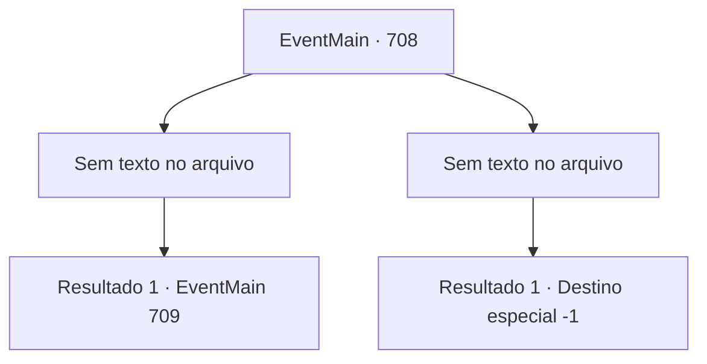

# Eventos principais · 708

[Índice da tabela](index.md) · [Índice geral](../index.md)

ID: `pt:EventMain:708` · Fonte: `EventMain4` · Versão: 1.2.47.

Mapeamento estático dos arquivos; a disponibilidade e a execução dependem do estado da run.

## Texto do evento

*Sem texto no arquivo.*

## Dados de entrada

```json
{
  "id": 708,
  "grade": 1,
  "normalGoal": "",
  "required": ""
}
```

## Mapa das escolhas



## Escolhas e resultados

### Escolha 1

*Sem texto no arquivo; o papel dessa opção depende da interface do jogo.*

Requisitos e outros campos da escolha:

```json
{
  "required": ""
}
```

#### Resultado 1.1

Você mata todos os paladinos e tira suas almas. Então você se aproxima de Viyork. 

 "H, Espere! Espere! Vou cooperar com você. Você quer matar Onil e Publius? Vou te ajudar!"

 Assustado, Viyork parece quase implorando. 

 "Você sabe como Teretian se move? Se você não sabe, eu te conto! É difícil trazer Publius aqui agora, mas... Se for Onil, eu o chamo bem na sua frente! O que você acha? Hein?"


Continuação registrada: [Evento 709](0709.md) na mesma tabela.

```json
{
  "required": "",
  "chance": "1",
  "nextEvent": 709,
  "type": 2,
  "reward": ""
}
```

### Escolha 2

*Sem texto no arquivo; o papel dessa opção depende da interface do jogo.*

Requisitos e outros campos da escolha:

```json
{
  "required": ""
}
```

#### Resultado 2.1


 "Conseguimos nos dar bem um com o outro, mas é uma pena."

 Viyork sussurra, cravando uma espada em seu coração. Ao mesmo tempo, a voz irritada de Kior é ouvida. 

 "Você é um tolo... Você disse para pensar sobre isso... É isso?"

 Você pede ajuda mais uma vez, mas sua voz não sai. No final, sua consciência cai na escuridão.

Continuação registrada: [Destino especial `-1`](../destinos-especiais.md).

```json
{
  "required": "",
  "chance": "1",
  "nextEvent": -1,
  "type": 2,
  "reward": "0_0_-1|0_1_-1|15_5_13"
}
```

## Referências que chegam a este evento

- [Evento 695 · escolha 2 · resultado 1](0695.md#escolha-2)
