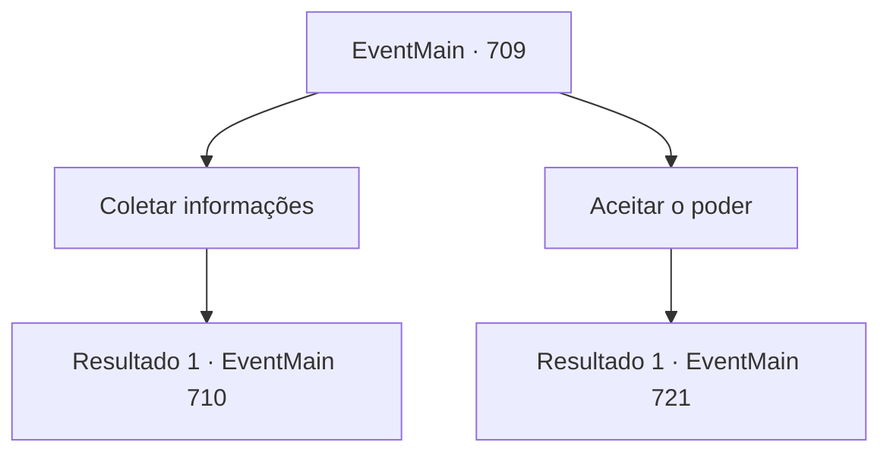

# Eventos principais · 709

[Índice da tabela](index.md) · [Índice geral](../index.md)

ID: `pt:EventMain:709` · Fonte: `EventMain4` · Versão: 1.2.47.

Mapeamento estático dos arquivos; a disponibilidade e a execução dependem do estado da run.

## Texto do evento

*Sem texto no arquivo.*

## Dados de entrada

```json
{
  "id": 709,
  "grade": 1,
  "normalGoal": "",
  "required": ""
}
```

## Mapa das escolhas



## Escolhas e resultados

### Escolha 1

Coletar informações

Requisitos e outros campos da escolha:

```json
{
  "required": ""
}
```

#### Resultado 1.1

Você obtém informações dele à força em vez de aceitar a oferta. Viyork, que está machucado, babando e revelando suas informações. 

 "Oh, Onil está acampado por aqui. Eu encontrei suas pegadas e pedi a ele por cooperação."

 Ele implora por sua vida, até mesmo explicando seu plano original. O plano é que ele te ataque primeiro, e Onil, que está esperando embaixo da montanha antecipadamente, te capture. 

 "I, Isso é tudo! Por favor, me salve!"

 Você tira o fôlego do suplicante Viyork e absorve sua alma. E desce a montanha em busca de Onil.  

 Logo em seguida, você encontra Onil acampado embaixo da montanha e se esconde cuidadosamente. Onil parece não ter te notado.

Continuação registrada: [Evento 710](0710.md) na mesma tabela.

```json
{
  "required": "",
  "chance": "1",
  "nextEvent": 710,
  "type": 2,
  "reward": ""
}
```

### Escolha 2

Aceitar o poder

Requisitos e outros campos da escolha:

```json
{
  "required": ""
}
```

#### Resultado 2.1

Você aceita a oferta e me diz como chamar Onil. Viyork responde com voz trêmula. 

 "Eu, eu vou enviar uma carta para Onil. Estou enviando uma carta dizendo que você me sequestrou, fazendo com que ele venha sozinho. O, o que você acha?"

 Após a explicação, ele escreve uma carta com um sorriso constrangido.

 Depois de um tempo, Viyork escreve a carta inteira e você a olha. Exceto pelos antigos modificadores que estão densamente escritos, todas as letras são como ele disse.

Continuação registrada: [Evento 721](0721.md) na mesma tabela.

```json
{
  "required": "",
  "chance": "1",
  "nextEvent": 721,
  "type": 2,
  "reward": ""
}
```

## Referências que chegam a este evento

- [Evento 708 · escolha 1 · resultado 1](0708.md#escolha-1)
