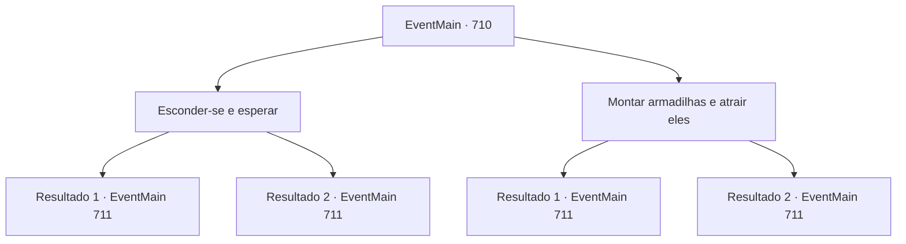

# Eventos principais · 710

[Índice da tabela](index.md) · [Índice geral](../index.md)

ID: `pt:EventMain:710` · Fonte: `EventMain4` · Versão: 1.2.47.

Mapeamento estático dos arquivos; a disponibilidade e a execução dependem do estado da run.

## Texto do evento

*Sem texto no arquivo.*

## Dados de entrada

```json
{
  "id": 710,
  "grade": 1,
  "normalGoal": "",
  "required": ""
}
```

## Mapa das escolhas



## Escolhas e resultados

### Escolha 1

Esconder-se e esperar

Requisitos e outros campos da escolha:

```json
{
  "required": ""
}
```

#### Resultado 1.1

Você observa Onil, esperando a noite chegar.  Onil permanece vigilante, e conforme o sol se põe, ele ordena aos paladinos que montem uma tenda.  Então ele os adverte para terem cuidado.  

 "Não baixem a guarda. Eu posso sentir o espírito do mal por perto."

  Você se aproxima de Onil com extrema cautela.  Um passo, um passo e mais um passo...  Então, finalmente chegando perto de Onil, você rapidamente salta e o ataca.  

 "Kek... Você...!"

  Onil, que permitiu o golpe, tropeça e puxa a espada.

Continuação registrada: [Evento 711](0711.md) na mesma tabela.

```json
{
  "required": "",
  "chance": "1|0_6_1",
  "nextEvent": 711,
  "type": 0,
  "reward": "6_2_145",
  "place": 1
}
```

#### Resultado 1.2

Você observa Onil, esperando a noite chegar. Onil permanece vigilante e, à medida que o sol se põe, ele ordena aos paladinos que montem uma tenda. Então ele os adverte para terem cuidado. 

 "Não baixem a guarda. Eu posso sentir o espírito do mal por perto."

 Você se aproxima de Onil com extrema cautela. Um passo, um passo e mais um passo... Então, finalmente chegando perto de Onil, você rapidamente salta e o ataca. Mas Onil calmamente para o seu ataque. 

 "Viyork... Ele foi derrotado no final!"

 Onil chama seus homens em voz alta e empunha sua espada contra você.

Continuação registrada: [Evento 711](0711.md) na mesma tabela.

```json
{
  "required": "",
  "chance": "16",
  "nextEvent": 711,
  "type": 1,
  "reward": "6_0_145",
  "place": 1
}
```

### Escolha 2

Montar armadilhas e atrair eles

Requisitos e outros campos da escolha:

```json
{
  "required": "8_38_1"
}
```

#### Resultado 2.1

Você volta para cima da montanha e cava buracos aqui e ali na rua. E então você desce novamente, grita no acampamento dos paladinos. Você grita que matou Viyork. Com sua provocação, Onil lidera seus homens a subir a montanha às pressas. Como resultado, os paladinos não conseguem escapar da armadilha e caem. Alguém rola para baixo e alguém quebra o tornozelo. 

 "Você...! Como se atreve... Você será punido por Tere!!"

 Onil e alguns de seus homens finalmente chegam até você, mas estão em uma bagunça. Você ataca ferozmente os destroçados deles.

Continuação registrada: [Evento 711](0711.md) na mesma tabela.

```json
{
  "required": "",
  "chance": "1|0_12_1",
  "nextEvent": 711,
  "type": 0,
  "reward": "4_38_1|6_2_145",
  "place": 1
}
```

#### Resultado 2.2

Você volta para cima da montanha e cava buracos aqui e ali na rua. E então você desce novamente, grita no acampamento dos paladinos. Você grita que matou Viyork. Com sua provocação, Onil lidera seus homens a subir a montanha às pressas. 

 "Você...! Como se atreve... Espere! É uma armadilha! Todos, cuidado!"

 Onil grita para os paladinos, que estão subindo a montanha rapidamente, e eles diminuem a velocidade. Eles se aproximam de você lentamente, olhando para a armadilha. Eventualmente, eles evitam todas as armadilhas e chegam até você em perfeitas condições. 

 "Peguem o demônio!"

 Com o grito de Onil, os paladinos avançam contra você.

Continuação registrada: [Evento 711](0711.md) na mesma tabela.

```json
{
  "required": "",
  "chance": "16",
  "nextEvent": 711,
  "type": 1,
  "reward": "4_38_1|6_0_145",
  "place": 1
}
```

## Referências que chegam a este evento

- [Evento 709 · escolha 1 · resultado 1](0709.md#escolha-1)
- [Evento 721 · escolha 1 · resultado 1](0721.md#escolha-1)
