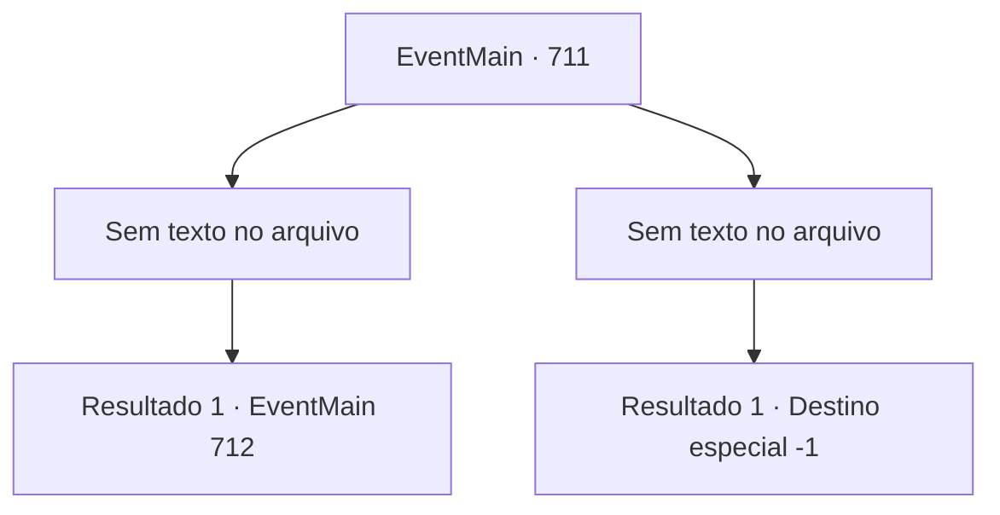

# Eventos principais · 711

[Índice da tabela](index.md) · [Índice geral](../index.md)

ID: `pt:EventMain:711` · Fonte: `EventMain4` · Versão: 1.2.47.

Mapeamento estático dos arquivos; a disponibilidade e a execução dependem do estado da run.

## Texto do evento

*Sem texto no arquivo.*

## Dados de entrada

```json
{
  "id": 711,
  "grade": 1,
  "normalGoal": "",
  "required": ""
}
```

## Mapa das escolhas



## Escolhas e resultados

### Escolha 1

*Sem texto no arquivo; o papel dessa opção depende da interface do jogo.*

Requisitos e outros campos da escolha:

```json
{
  "required": ""
}
```

#### Resultado 1.1

Vocês que roubam as almas dos paladinos se aproximam do caído Onil e agarram sua cabeça.  E até mesmo sua alma é sugada através de sua mão.  |drawing_drain|  Depois de um tempo, Onil, privado de toda sua alma, se torna um cadáver branco e seco.  Você sorri inconscientemente e encontra um pergaminho no corpo.  É uma diretiva com o selo de Tere.  Diz, como Viyork disse, que Onil e Viyork estão trabalhando juntos e que a maioria dos paladinos está procurando por você.

  'Desejo-lhe sorte. Onil. Espere por você na Catedral de Yerut.'

  Enquanto você rasga a diretiva, você ouve a voz de Kior.  

 "Agora é o momento em que a maioria dos Paladinos está fora da Catedral de Yerut. Agora, vá para a catedral."

 Kior instiga você a invadir a catedral imediatamente.  Você pode ver cavalos que parecem ter sido montados pelos paladinos.

Continuação registrada: [Evento 712](0712.md) na mesma tabela.

```json
{
  "required": "",
  "chance": "1",
  "nextEvent": 712,
  "type": 2,
  "reward": "3_249_1"
}
```

### Escolha 2

*Sem texto no arquivo; o papel dessa opção depende da interface do jogo.*

Requisitos e outros campos da escolha:

```json
{
  "required": ""
}
```

#### Resultado 2.1


 "... É o fim."

 Esmagado pela espada de Onil no coração, você vomita sangue. Através da consciência desvanecida, a voz decepcionada de Kior é ouvida. 

 "Você deveria ter me seguido..."

 Você pede por outra chance, mas sua voz não sai. Finalmente, sua consciência cai na escuridão.

Continuação registrada: [Destino especial `-1`](../destinos-especiais.md).

```json
{
  "required": "",
  "chance": "1",
  "nextEvent": -1,
  "type": 2,
  "reward": "15_5_13"
}
```

## Referências que chegam a este evento

- [Evento 710 · escolha 1 · resultado 1](0710.md#escolha-1)
- [Evento 710 · escolha 1 · resultado 2](0710.md#escolha-1)
- [Evento 710 · escolha 2 · resultado 1](0710.md#escolha-2)
- [Evento 710 · escolha 2 · resultado 2](0710.md#escolha-2)
