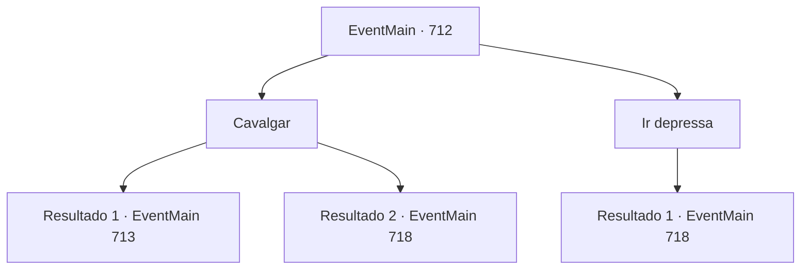

# Eventos principais · 712

[Índice da tabela](index.md) · [Índice geral](../index.md)

ID: `pt:EventMain:712` · Fonte: `EventMain4` · Versão: 1.2.47.

Mapeamento estático dos arquivos; a disponibilidade e a execução dependem do estado da run.

## Texto do evento

*Sem texto no arquivo.*

## Dados de entrada

```json
{
  "id": 712,
  "grade": 1,
  "normalGoal": "",
  "required": ""
}
```

## Mapa das escolhas



## Escolhas e resultados

### Escolha 1

Cavalgar

Requisitos e outros campos da escolha:

```json
{
  "required": ""
}
```

#### Resultado 1.1

Você cavalga seu cavalo até a catedral onde Publius está. Felizmente, os cavalos são dóceis e seguem seu controle, pois os paladinos os domaram bem. |drawing_tereCathedral| Alguns dias depois, a Catedral de Yerut, que chegou, é um lugar esplêndido. Todo o prédio é feito de mármore, com uma cúpula azul no topo. Por toda a parede externa há esculturas e pinturas em mosaico em homenagem aos santos de Teretian. 

 "Finalmente, que chega até aqui."

 Enquanto você está em frente à catedral, Publius aparece, liderando os paladinos. Os paladinos são poucos em número, mas estão cercados por uma luz brilhante. 

 "Todos! Matem o demônio!"

 Eles, cercados pela luz, avançam em sua direção com o grito de Publius. Você rapidamente saca sua arma e entra na luta.

Continuação registrada: [Evento 713](0713.md) na mesma tabela.

```json
{
  "required": "",
  "chance": "1|0_12_1",
  "nextEvent": 713,
  "type": 0,
  "reward": "6_0_149",
  "place": 4
}
```

#### Resultado 1.2

Tentas montar o teu cavalo em direção à catedral onde está Publius. Mas os cavalos não seguem o teu controlo. Eles apenas lutam com raiva. Eventualmente, abandonas o teu cavalo e diriges-te à catedral a pé. |drawing_tereCathedral| Alguns dias depois, chegas à Catedral de Yerut, que é um lugar esplêndido. Todo o edifício é feito de mármore, com uma cúpula azul no topo. Por toda a parede exterior existem esculturas e pinturas em mosaico em honra dos santos de Teretian. 

 "Finalmente, cheguei até aqui."

 Enquanto estás em frente à catedral, Publius aparece, liderando os paladinos. Os paladinos são poucos em número, mas estão rodeados por uma luz brilhante. E ao contrário do conteúdo da diretiva, Valen também está lá. 

 "Todos! Protejam o Arcebispo! Matem esse demônio!"

 Ao grito de Valen, os paladinos rodeados pela luz avançam contra ti.

Continuação registrada: [Evento 718](0718.md) na mesma tabela.

```json
{
  "required": "",
  "chance": "14",
  "nextEvent": 718,
  "type": 1,
  "reward": "6_3_148",
  "place": 4
}
```

### Escolha 2

Ir depressa

Requisitos e outros campos da escolha:

```json
{
  "required": ""
}
```

#### Resultado 2.1

Você segue para a catedral a pé. |drawing_tereCathedral| Alguns dias depois, a Catedral de Yerut, que chegou, é um lugar esplêndido. Todo o prédio é feito de mármore, com uma cúpula azul no topo. Por toda a parede externa, há esculturas e pinturas em mosaico em homenagem aos santos de Teretian. 

 "Finalmente, que chega até aqui."

 Enquanto você está em frente à catedral, Publius aparece, liderando os paladinos. Os paladinos são poucos em número, mas estão cercados por uma luz brilhante. E, ao contrário do conteúdo da diretiva, Valen também está lá. 

 "Todos! Protejam o Arcebispo! Matem aquele demônio!"

 Ao grito de Valen, os paladinos cercados pela luz avançam em sua direção.

Continuação registrada: [Evento 718](0718.md) na mesma tabela.

```json
{
  "required": "",
  "chance": "1",
  "nextEvent": 718,
  "type": 2,
  "reward": "6_3_148",
  "place": 4
}
```

## Referências que chegam a este evento

- [Evento 711 · escolha 1 · resultado 1](0711.md#escolha-1)
