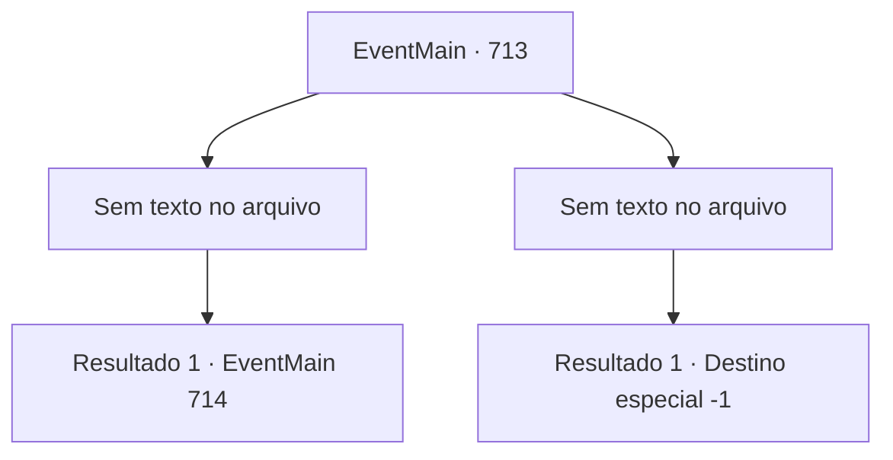

# Eventos principais · 713

[Índice da tabela](index.md) · [Índice geral](../index.md)

ID: `pt:EventMain:713` · Fonte: `EventMain4` · Versão: 1.2.47.

Mapeamento estático dos arquivos; a disponibilidade e a execução dependem do estado da run.

## Texto do evento

*Sem texto no arquivo.*

## Dados de entrada

```json
{
  "id": 713,
  "grade": 1,
  "normalGoal": "",
  "required": ""
}
```

## Mapa das escolhas



## Escolhas e resultados

### Escolha 1

*Sem texto no arquivo; o papel dessa opção depende da interface do jogo.*

Requisitos e outros campos da escolha:

```json
{
  "required": ""
}
```

#### Resultado 1.1

A audaz carga dos paladinos é aterrorizante.  Mas essa carga não pode te matar.  Eles caem em suas mãos e são deixados ao contar de um.  Justo então. Publius se coloca em seu caminho.  

 "Eu me rendo. Então, leve minha vida e pare de matar sem sentido."

  Seu olhar sério se dirige a você.

Continuação registrada: [Evento 714](0714.md) na mesma tabela.

```json
{
  "required": "",
  "chance": "1",
  "nextEvent": 714,
  "type": 2,
  "reward": ""
}
```

### Escolha 2

*Sem texto no arquivo; o papel dessa opção depende da interface do jogo.*

Requisitos e outros campos da escolha:

```json
{
  "required": ""
}
```

#### Resultado 2.1

A intensa luz de Publius penetra em seu corpo.  Sua consciência fica embaçada com a luz, e você ouve a voz de um Kior decepcionado.  

 "Acabar assim... Isso é patético..."

  Você tenta pedir por outra chance, mas sua voz não sai.  Você falha em sua vingança.

Continuação registrada: [Destino especial `-1`](../destinos-especiais.md).

```json
{
  "required": "",
  "chance": "1",
  "nextEvent": -1,
  "type": 2,
  "reward": "0_0_-1|0_1_-1|15_5_13|15_5_17"
}
```

## Referências que chegam a este evento

- [Evento 712 · escolha 1 · resultado 1](0712.md#escolha-1)
