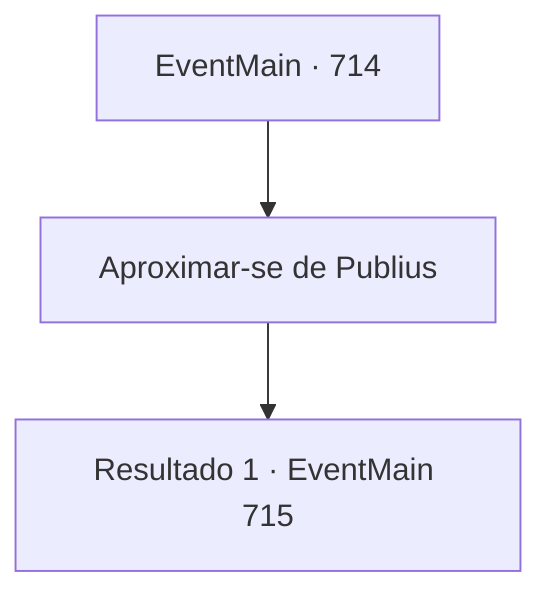

# Eventos principais · 714

[Índice da tabela](index.md) · [Índice geral](../index.md)

ID: `pt:EventMain:714` · Fonte: `EventMain4` · Versão: 1.2.47.

Mapeamento estático dos arquivos; a disponibilidade e a execução dependem do estado da run.

## Texto do evento

*Sem texto no arquivo.*

## Dados de entrada

```json
{
  "id": 714,
  "grade": 1,
  "normalGoal": "",
  "required": ""
}
```

## Mapa das escolhas



## Escolhas e resultados

### Escolha 1

Aproximar-se de Publius

Requisitos e outros campos da escolha:

```json
{
  "required": ""
}
```

#### Resultado 1.1

Você pega a espada que tinha caído no chão e se aproxima de Publius. Ele pergunta em voz baixa, sem desviar o olhar de você. 

 "Por favor, responda uma coisa antes de me matar. Por que diabos você está fazendo isso? Por que você faz uma coisa tão terrível?"


Continuação registrada: [Evento 715](0715.md) na mesma tabela.

```json
{
  "required": "",
  "chance": "1",
  "nextEvent": 715,
  "type": 2,
  "reward": ""
}
```

## Referências que chegam a este evento

- [Evento 713 · escolha 1 · resultado 1](0713.md#escolha-1)
