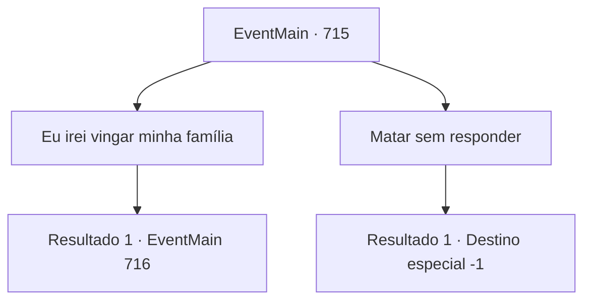

# Eventos principais · 715

[Índice da tabela](index.md) · [Índice geral](../index.md)

ID: `pt:EventMain:715` · Fonte: `EventMain4` · Versão: 1.2.47.

Mapeamento estático dos arquivos; a disponibilidade e a execução dependem do estado da run.

## Texto do evento

*Sem texto no arquivo.*

## Dados de entrada

```json
{
  "id": 715,
  "grade": 1,
  "normalGoal": "",
  "required": ""
}
```

## Mapa das escolhas



## Escolhas e resultados

### Escolha 1

Eu irei vingar minha família

Requisitos e outros campos da escolha:

```json
{
  "required": ""
}
```

#### Resultado 1.1

Com suas palavras, Publius abre a boca com uma expressão surpresa. 

 "Vingança da família...? De jeito nenhum. Eu queimei tudo para que isso não acontecesse..."

 Você aponta sua arma para ele. Publius olha para cima com olhos vazios e levanta a cabeça como se algo lhe ocorresse de repente. 

 "... Entendo. É assim. Foi tudo parte do plano dele..."

 Com uma voz misturada, Publius continua. 

 "Mesmo que você me mate, sua vingança não vai acabar. Porque há um objeto separado pelo qual você realmente precisa se vingar."

 Publius diz que está muito próximo de você. E que teria dito coisas doces para você. Ele disse que é o demônio, Kior. 

 "Não se deixe enganar. {1}."

 Com o fim das palavras de Publius, há um sussurro de Kior.

Continuação registrada: [Evento 716](0716.md) na mesma tabela.

```json
{
  "required": "",
  "chance": "1",
  "nextEvent": 716,
  "type": 2,
  "reward": ""
}
```

### Escolha 2

Matar sem responder

Requisitos e outros campos da escolha:

```json
{
  "required": ""
}
```

#### Resultado 2.1

Você enfia a espada no coração de Publius sem responder. Sangue jorra de sua boca e seus olhos embaçam lentamente. Você, que matou Publius, mata até mesmo os paladinos sobreviventes ao seu redor. 

 "Khahahah! Ótimo trabalho. {1}. Agora dedique suas almas a mim."

 A selvagem risada de Kior é ouvida. Conforme ele diz, você recupera todas as almas ali e as dedica a Kior. 

 "Hahaha. Posso sentir a energia. Bem, vamos buscar mais vingança. Apague Teretian do mundo."

 Você assente e sai dali em suas palavras.

Continuação registrada: [Destino especial `-1`](../destinos-especiais.md).

```json
{
  "required": "",
  "chance": "1",
  "nextEvent": -1,
  "type": 2,
  "reward": "15_5_8|15_5_14|15_5_27"
}
```

## Referências que chegam a este evento

- [Evento 714 · escolha 1 · resultado 1](0714.md#escolha-1)
