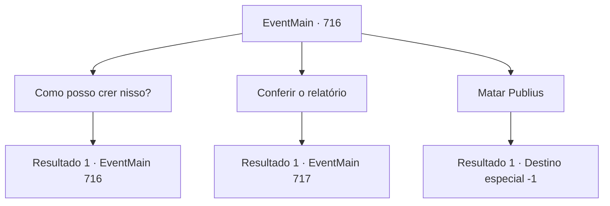

# Eventos principais · 716

[Índice da tabela](index.md) · [Índice geral](../index.md)

ID: `pt:EventMain:716` · Fonte: `EventMain4` · Versão: 1.2.47.

Mapeamento estático dos arquivos; a disponibilidade e a execução dependem do estado da run.

## Texto do evento

*Sem texto no arquivo.*

## Dados de entrada

```json
{
  "id": 716,
  "grade": 1,
  "normalGoal": "",
  "required": ""
}
```

## Mapa das escolhas



## Escolhas e resultados

### Escolha 1

Como posso crer nisso?

Requisitos e outros campos da escolha:

```json
{
  "required": "5_410_0"
}
```

#### Resultado 1.1

Em resposta à sua pergunta, Publius aponta para a catedral e diz:  

 "Há um registro de Kior na catedral. Se quiser, eu te mostro."

  Kior sussurra como se estivesse contradizendo suas palavras.  

 "Falando sobre qualquer coisa porque ele quer viver. Não precisa ouvir mais."


Continuação registrada: [Evento 716](0716.md) na mesma tabela.

```json
{
  "required": "",
  "chance": "1",
  "nextEvent": 716,
  "type": 2,
  "reward": "5_410_1"
}
```

### Escolha 2

Conferir o relatório

Requisitos e outros campos da escolha:

```json
{
  "required": "5_410_1"
}
```

#### Resultado 2.1

Você segue Publius até a catedral. Então uma forte força divina pesa em seu ombro. Kior resmunga sobre a barreira de Tere, e Publius te leva para um lugar mais profundo. Você pode ver a biblioteca enquanto caminha pelo corredor feito de mármore branco por um longo tempo. Publius abre a porta e logo traz um livro antigo. 

 "Este é o registro de Kior. Verifique por si mesmo."

 E no momento em que você tenta verificar os registros. 

 'Clang!' 

 A janela da catedral se quebra, e alguém pula dentro. Ela é Valen, uma paladina de cabelos vermelhos. Sua espada é balançada em sua direção, cortando o vento.

Continuação registrada: [Evento 717](0717.md) na mesma tabela.

```json
{
  "required": "",
  "chance": "1",
  "nextEvent": 717,
  "type": 2,
  "reward": "6_3_148",
  "place": 10
}
```

### Escolha 3

Matar Publius

Requisitos e outros campos da escolha:

```json
{
  "required": ""
}
```

#### Resultado 3.1

Você enfia a espada no coração de Publius sem responder. Sangue jorra de sua boca e seus olhos embaçam lentamente. Você, que matou Publius, mata até mesmo os paladinos sobreviventes ao seu redor. 

 "Khahahah! Ótimo trabalho. {1}. Agora dedique suas almas a mim."

 A selvagem risada de Kior é ouvida. Como ele diz, você recupera todas as almas ali e as dedica a Kior. 

 "Hahaha. Eu posso sentir a energia. Bem, vamos buscar mais vingança. Apague Teretian do mundo."

 Você assente e sai dali em suas palavras.

Continuação registrada: [Destino especial `-1`](../destinos-especiais.md).

```json
{
  "required": "",
  "chance": "1",
  "nextEvent": -1,
  "type": 2,
  "reward": "15_5_8|15_5_14|15_5_27"
}
```

## Referências que chegam a este evento

- [Evento 715 · escolha 1 · resultado 1](0715.md#escolha-1)
- [Evento 716 · escolha 1 · resultado 1](0716.md#escolha-1)
