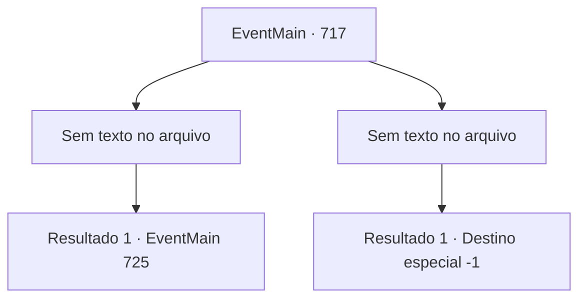

# Eventos principais · 717

[Índice da tabela](index.md) · [Índice geral](../index.md)

ID: `pt:EventMain:717` · Fonte: `EventMain4` · Versão: 1.2.47.

Mapeamento estático dos arquivos; a disponibilidade e a execução dependem do estado da run.

## Texto do evento

*Sem texto no arquivo.*

## Dados de entrada

```json
{
  "id": 717,
  "grade": 1,
  "normalGoal": "",
  "required": ""
}
```

## Mapa das escolhas



## Escolhas e resultados

### Escolha 1

*Sem texto no arquivo; o papel dessa opção depende da interface do jogo.*

Requisitos e outros campos da escolha:

```json
{
  "required": ""
}
```

#### Resultado 1.1


 "Va, Valen...!!"

 Com um grito agudo de Publius, a espada de Valen cai no chão. E então seu corpo cai. Sangue vermelho vaza e colore o mármore branco. Você pega sua espada e se aproxima de Publius. Publius dá um passo para trás, olhando para você. Mas é inútil. Você junta a espada de Valen e o corpo de Publius. E todas as almas na catedral são dedicadas a Kior. Então, a voz satisfeita de Kior é ouvida. 

 "Khahaha!!! Ótimo! É excelente! Sinto muito que você não tenha acreditado em mim e tenha trazido perigo, mas... Vou recompensar sua dedicação. Receba minha força. Vou te dar a força que você nunca experimentou antes."

 E então, com esse poder, Ele te ordena apagar tudo sobre Tere.

Continuação registrada: [Evento 725](0725.md) na mesma tabela.

```json
{
  "required": "",
  "chance": "1",
  "nextEvent": 725,
  "type": 2,
  "reward": ""
}
```

### Escolha 2

*Sem texto no arquivo; o papel dessa opção depende da interface do jogo.*

Requisitos e outros campos da escolha:

```json
{
  "required": ""
}
```

#### Resultado 2.1

Devido à Barreira, você não consegue obter poder suficiente. Em uma situação como essa, é natural que você seja derrotado. A espada de Valen é cravada em seu pescoço, e você ouve Kior te repreender. 

 "Que idiota! Você deveria ter me ouvido!"

 Você falha em se vingar assim e é colocado em uma prisão fria.

Continuação registrada: [Destino especial `-1`](../destinos-especiais.md).

```json
{
  "required": "",
  "chance": "1",
  "nextEvent": -1,
  "type": 2,
  "reward": "0_0_-1|0_1_-1|15_5_2|15_5_13"
}
```

## Referências que chegam a este evento

- [Evento 716 · escolha 2 · resultado 1](0716.md#escolha-2)
