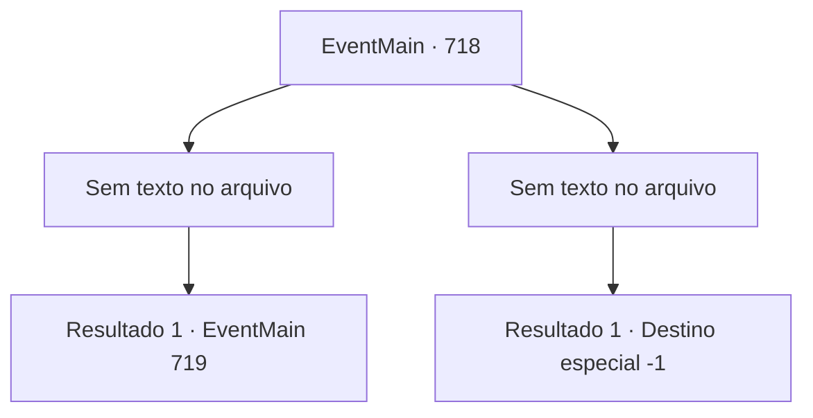

# Eventos principais · 718

[Índice da tabela](index.md) · [Índice geral](../index.md)

ID: `pt:EventMain:718` · Fonte: `EventMain4` · Versão: 1.2.47.

Mapeamento estático dos arquivos; a disponibilidade e a execução dependem do estado da run.

## Texto do evento

*Sem texto no arquivo.*

## Dados de entrada

```json
{
  "id": 718,
  "grade": 1,
  "normalGoal": "",
  "required": ""
}
```

## Mapa das escolhas



## Escolhas e resultados

### Escolha 1

*Sem texto no arquivo; o papel dessa opção depende da interface do jogo.*

Requisitos e outros campos da escolha:

```json
{
  "required": ""
}
```

#### Resultado 1.1

Você derruba Valen e se aproxima para matá-la. E no momento em que sua arma está prestes a alcançar o pescoço de Valen, você ouve a voz de Publius. A voz é poderosa o suficiente para te forçar. <b><link=shake>

 "Ajoelhe-se!"

</link></b> O que Publius diz é um feitiço chamado 'palavra de poder' que força a ação de alguém. Suas pernas estão tentando se ajoelhar independentemente da sua vontade.

Continuação registrada: [Evento 719](0719.md) na mesma tabela.

```json
{
  "required": "",
  "chance": "1",
  "nextEvent": 719,
  "type": 2,
  "reward": ""
}
```

### Escolha 2

*Sem texto no arquivo; o papel dessa opção depende da interface do jogo.*

Requisitos e outros campos da escolha:

```json
{
  "required": ""
}
```

#### Resultado 2.1

Você não é páreo para os paladinos que são liderados por Valen. A voz de Valen é ouvida na consciência que se desvanece. 

 "Um servo maligno. Não pense que você morrerá em paz."

 Ao ouvir a voz, você sente que tudo acabou.

Continuação registrada: [Destino especial `-1`](../destinos-especiais.md).

```json
{
  "required": "",
  "chance": "1",
  "nextEvent": -1,
  "type": 2,
  "reward": "0_0_-1|0_1_-1|15_5_2|15_5_13"
}
```

## Referências que chegam a este evento

- [Evento 712 · escolha 1 · resultado 2](0712.md#escolha-1)
- [Evento 712 · escolha 2 · resultado 1](0712.md#escolha-2)
