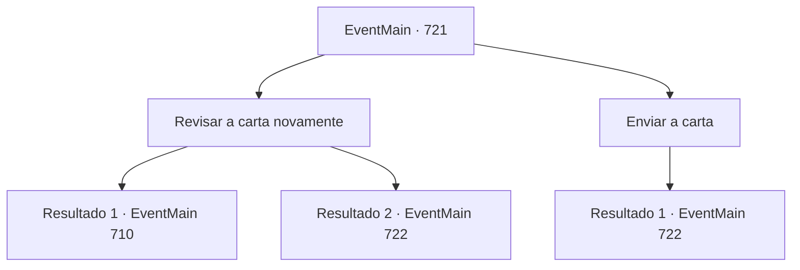

# Eventos principais · 721

[Índice da tabela](index.md) · [Índice geral](../index.md)

ID: `pt:EventMain:721` · Fonte: `EventMain4` · Versão: 1.2.47.

Mapeamento estático dos arquivos; a disponibilidade e a execução dependem do estado da run.

## Texto do evento

*Sem texto no arquivo.*

## Dados de entrada

```json
{
  "id": 721,
  "grade": 1,
  "normalGoal": "",
  "required": ""
}
```

## Mapa das escolhas



## Escolhas e resultados

### Escolha 1

Revisar a carta novamente

Requisitos e outros campos da escolha:

```json
{
  "required": ""
}
```

#### Resultado 1.1

Você olha para a carta novamente e encontra algo suspeito.  Uma frase oculta apareceu quando você leu apenas a primeira letra da carta. 

 'Eu encontrei {1}. Vou fingir ser pego, então se apresse e venha.'  Após verificar a frase, você devolve a carta para ele calmamente.  E no momento em que ele chama um pombo correio e envia uma carta, você o ataca por trás e o mata.  

 "K..hu...k...!"

  Você absorve a alma do corpo do Viyork morto e desce a montanha para encontrar Onil.  Quando você encontra Onil acampando sob a montanha, você se esconde cuidadosamente. 

 Onil está gritando com seus homens sem perceber você.

Continuação registrada: [Evento 710](0710.md) na mesma tabela.

```json
{
  "required": "",
  "chance": "1|0_14_1",
  "nextEvent": 710,
  "type": 0,
  "reward": ""
}
```

#### Resultado 1.2

Nada suspeito sobre a carta, mesmo se você olhar novamente. Você devolve a carta para ele e pede para ele se apressar. Após chamar um pombo correio, Viyork amarra uma carta em seus pés e a envia para o céu. 

 "Em breve... Onil virá me ver. Vou fingir desmaiar. Amarre-me solto naquela árvore."

 Você o amarra em uma árvore e espera por Onil, como Viyork disse. Onil aparece algumas horas depois.

 Onil, que finalmente aparece, está segurando uma carta. Ele alterna entre você e Viyork amarrado na árvore e fala em voz baixa. 

 "Conforme prometido, eu venho sozinho, então solte Viyork."


Continuação registrada: [Evento 722](0722.md) na mesma tabela.

```json
{
  "required": "",
  "chance": "16",
  "nextEvent": 722,
  "type": 1,
  "reward": ""
}
```

### Escolha 2

Enviar a carta

Requisitos e outros campos da escolha:

```json
{
  "required": ""
}
```

#### Resultado 2.1

Você devolve a carta e pede para Viyork se apressar. Então Viyork chama um pombo correio com um sorriso constrangido, amarra uma carta em seus pés e a envia para o céu. 

 "Em breve... Onil virá me ver. Vou fingir desmaiar. Amarre-me solto naquela árvore."

 Você o amarra em uma árvore e espera por Onil, como Viyork disse. Onil aparece algumas horas depois.

 Onil, que finalmente aparece, está segurando uma carta. Ele alterna entre você e Viyork amarrado à árvore e fala em voz baixa. 

 "Conforme prometido, eu venho sozinho, então liberte Viyork."


Continuação registrada: [Evento 722](0722.md) na mesma tabela.

```json
{
  "required": "",
  "chance": "1",
  "nextEvent": 722,
  "type": 2,
  "reward": ""
}
```

## Referências que chegam a este evento

- [Evento 709 · escolha 2 · resultado 1](0709.md#escolha-2)
