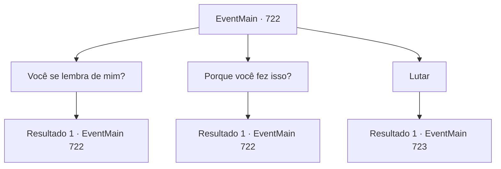

# Eventos principais · 722

[Índice da tabela](index.md) · [Índice geral](../index.md)

ID: `pt:EventMain:722` · Fonte: `EventMain4` · Versão: 1.2.47.

Mapeamento estático dos arquivos; a disponibilidade e a execução dependem do estado da run.

## Texto do evento

*Sem texto no arquivo.*

## Dados de entrada

```json
{
  "id": 722,
  "grade": 1,
  "normalGoal": "",
  "required": ""
}
```

## Mapa das escolhas



## Escolhas e resultados

### Escolha 1

Você se lembra de mim?

Requisitos e outros campos da escolha:

```json
{
  "required": "5_411_0"
}
```

#### Resultado 1.1

Você pergunta a Onil: 'Você se lembra de mim?' Com a pergunta, Onil fica surpreso, franzindo a testa e olhando para você. 

 "...Você foi queimado...! Como?"

 E logo em seguida, ele te encara com um olhar de raiva. 

 "Eu não sei o que aconteceu, mas... Vingança? Então Viyork e os outros não estariam envolvidos?"


Continuação registrada: [Evento 722](0722.md) na mesma tabela.

```json
{
  "required": "",
  "chance": "1",
  "nextEvent": 722,
  "type": 2,
  "reward": "5_411_1"
}
```

### Escolha 2

Porque você fez isso?

Requisitos e outros campos da escolha:

```json
{
  "required": "5_411_1"
}
```

#### Resultado 2.1

Você não responde Onil e faz uma segunda pergunta.

 'Por que você fez isso?'
 se era necessário matar sua esposa dedicada e seu filho jovem, que tinha apenas sete anos, de uma maneira tão terrível. Onil olha para você com a boca fechada por um momento. E olha diretamente para você e fala com voz confiante. 

 "Foi pela justiça."


Continuação registrada: [Evento 722](0722.md) na mesma tabela.

```json
{
  "required": "",
  "chance": "1",
  "nextEvent": 722,
  "type": 2,
  "reward": "5_411_2"
}
```

### Escolha 3

Lutar

Requisitos e outros campos da escolha:

```json
{
  "required": "5_411_2"
}
```

#### Resultado 3.1

Você se prepara para a luta, encarando Onil. Onil responde às suas ações tirando sua espada sem dizer nada. 

 "Agora... Acabe com isso!"

 Você e Onil correm um em direção ao outro ao mesmo tempo.

Continuação registrada: [Evento 723](0723.md) na mesma tabela.

```json
{
  "required": "",
  "chance": "1",
  "nextEvent": 723,
  "type": 2,
  "reward": "6_0_145",
  "place": 1
}
```

## Referências que chegam a este evento

- [Evento 721 · escolha 1 · resultado 2](0721.md#escolha-1)
- [Evento 721 · escolha 2 · resultado 1](0721.md#escolha-2)
- [Evento 722 · escolha 1 · resultado 1](0722.md#escolha-1)
- [Evento 722 · escolha 2 · resultado 1](0722.md#escolha-2)
