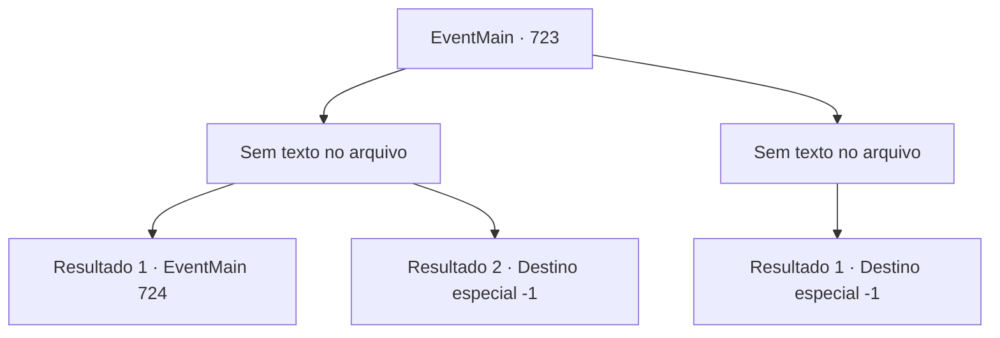

# Eventos principais · 723

[Índice da tabela](index.md) · [Índice geral](../index.md)

ID: `pt:EventMain:723` · Fonte: `EventMain4` · Versão: 1.2.47.

Mapeamento estático dos arquivos; a disponibilidade e a execução dependem do estado da run.

## Texto do evento

*Sem texto no arquivo.*

## Dados de entrada

```json
{
  "id": 723,
  "grade": 1,
  "normalGoal": "",
  "required": ""
}
```

## Mapa das escolhas



## Escolhas e resultados

### Escolha 1

*Sem texto no arquivo; o papel dessa opção depende da interface do jogo.*

Requisitos e outros campos da escolha:

```json
{
  "required": ""
}
```

#### Resultado 1.1

Você chuta Onil nas costelas, bloqueando sua espada. Então ele tropeça, e você está prestes a dar o golpe final. <color=red> 

 "Ha ha ha ha! Seu idiota!"

</color> De repente, há um escárnio com a intensa dor atrás de você. Antes que você perceba, Viyork, que desce da corda, te apunhala. Você olha bem na frente dos seus olhos, sentindo todo o seu corpo perder força. Enquanto isso, a espada de Onil está voando em sua direção.

Continuação registrada: [Evento 724](0724.md) na mesma tabela.

```json
{
  "required": "1_0_2",
  "chance": "1",
  "nextEvent": 724,
  "type": 2,
  "reward": "0_0_-1"
}
```

#### Resultado 1.2

Você chuta Onil nas costelas, bloqueando sua espada. Então ele tropeça, e você está prestes a dar o golpe final. <color=red> 

 "Ha ha ha ha! Seu idiota!"

</color> De repente, há um escárnio com uma dor intensa atrás de você. Antes que perceba, Viyork, que desce da corda, te apunhala. Você sente todo o seu corpo perder força e cair.

Continuação registrada: [Destino especial `-1`](../destinos-especiais.md).

```json
{
  "required": "2_0_2",
  "chance": "1",
  "nextEvent": -1,
  "type": 2,
  "reward": "0_0_-1|15_5_13|15_5_25"
}
```

### Escolha 2

*Sem texto no arquivo; o papel dessa opção depende da interface do jogo.*

Requisitos e outros campos da escolha:

```json
{
  "required": ""
}
```

#### Resultado 2.1


 "... É o fim."

 Esmagado pela espada de Onil no coração, você vomita sangue. Através da consciência que está desaparecendo, a voz de Viyork é ouvida. 

 "Eu teria me adiantado se fosse perigoso, mas não precisei."

 Ele pretendia te trair desde o início. Mas sua consciência está na escuridão antes que você possa ficar com raiva dele.

Continuação registrada: [Destino especial `-1`](../destinos-especiais.md).

```json
{
  "required": "",
  "chance": "1",
  "nextEvent": -1,
  "type": 2,
  "reward": "0_0_-1|0_1_-1|15_5_13|15_5_25"
}
```

## Referências que chegam a este evento

- [Evento 722 · escolha 3 · resultado 1](0722.md#escolha-3)
