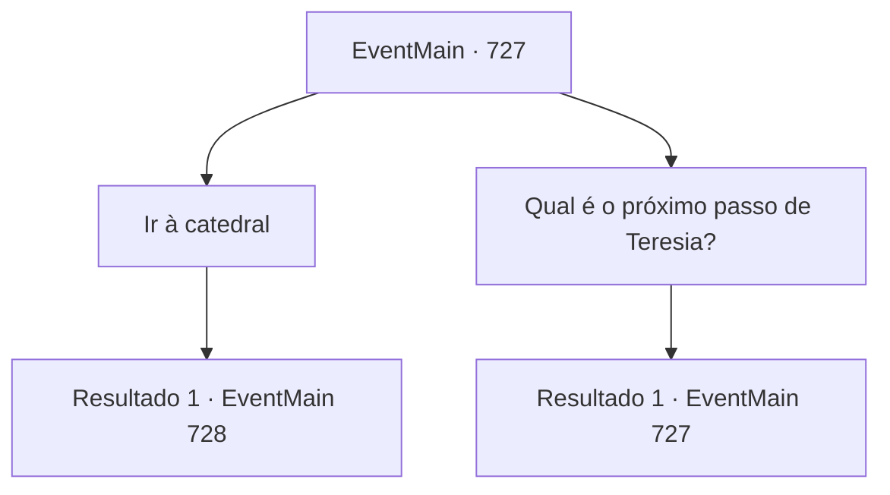

# Eventos principais · 727

[Índice da tabela](index.md) · [Índice geral](../index.md)

ID: `pt:EventMain:727` · Fonte: `EventMain4` · Versão: 1.2.47.

Mapeamento estático dos arquivos; a disponibilidade e a execução dependem do estado da run.

## Texto do evento

Quando você voltou para encontrar os seguidores do culto demoníaco, eles haviam se estabelecido em uma fortaleza em ruínas. O local estava repleto de caveiras e cabeças de animais penduradas, criando uma atmosfera sinistra e ameaçadora.  Gess o recebeu com uma voz animada e disse: 

 "E-eu descobri a localização de Publius. Ele está na grande ca-catedral de Yerut."

  Gess falou sobre a catedral de Yerut, dizendo que era considerada um santuário da Igreja de Tere. Em seguida, ele rapidamente sugeriu invadir a catedral para destruir a Igreja de Tere.  

 "Vamos matar aquele desgraçado! Vamos construir o altar do nosso mestre lá, na catedral! He... hehehe!!"


## Dados de entrada

```json
{
  "id": 727,
  "grade": 1,
  "normalGoal": "",
  "required": "1_2_100|13_4_18"
}
```

## Mapa das escolhas



## Escolhas e resultados

### Escolha 1

Ir à catedral

Requisitos e outros campos da escolha:

```json
{
  "required": ""
}
```

#### Resultado 1.1

Você lidera os adoradores até a Catedral de Yerut por sugestão de Gess. A catedral fica em Regirique e leva cerca de 10 dias para chegar lá. 

 Depois de caminhar assim por alguns dias, você de repente se vira para o som de batidas vindas do céu. O som é de um corvo. O corvo voa para o ombro de Gess e lhe entrega um bilhete com um pedaço em sua boca. 

 "T, Isso...?"

 Gess olha para o bilhete e franze a testa, e mostra para você. Ele contém as ações suspeitas de Teretian.

 'Relatório. Esta manhã, vários vagões saíram da catedral ao mesmo tempo.'

Continuação registrada: [Evento 728](0728.md) na mesma tabela.

```json
{
  "required": "",
  "chance": "1",
  "nextEvent": 728,
  "type": 2,
  "reward": ""
}
```

### Escolha 2

Qual é o próximo passo de Teresia?

Requisitos e outros campos da escolha:

```json
{
  "required": "5_412_0"
}
```

#### Resultado 2.1

Você pergunta a Gess sobre os movimentos de Teretian. Gess responde à pergunta com tosses. 

 "De acordo com um relatório de um espião, eles andam por aí e colocam um distintivo de procurado. Não há outro movimento."

 Então Gess ri, dizendo: 'Após a derrota da força punitiva, eles devem ter ficado assustados.'

Continuação registrada: [Evento 727](0727.md) na mesma tabela.

```json
{
  "required": "",
  "chance": "1",
  "nextEvent": 727,
  "type": 2,
  "reward": "5_412_1"
}
```

## Referências que chegam a este evento

- [Evento 727 · escolha 2 · resultado 1](0727.md#escolha-2)
