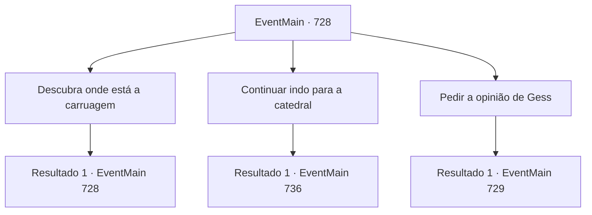

# Eventos principais · 728

[Índice da tabela](index.md) · [Índice geral](../index.md)

ID: `pt:EventMain:728` · Fonte: `EventMain4` · Versão: 1.2.47.

Mapeamento estático dos arquivos; a disponibilidade e a execução dependem do estado da run.

## Texto do evento

*Sem texto no arquivo.*

## Dados de entrada

```json
{
  "id": 728,
  "grade": 1,
  "normalGoal": "",
  "required": ""
}
```

## Mapa das escolhas



## Escolhas e resultados

### Escolha 1

Descubra onde está a carruagem

Requisitos e outros campos da escolha:

```json
{
  "required": "5_413_0"
}
```

#### Resultado 1.1

Sentindo-se suspeito, você exige que os adoradores persigam o paradeiro da carruagem. E você espera por notícias da vila próxima.

 No dia seguinte, os adoradores retornam e relatam as informações que trouxeram. Mas as informações trazidas pelos adoradores são contraditórias. 

 "A carruagem dos Teretianos está indo em direção à Montanha Grandeum."

 "A carruagem dos Teretianos está passando pelo caminho do louvor."

 "A carruagem dos Teretianos está seguindo o Rio Kaleres."

 Gess os ouve e murmura: 'É uma artimanha para esconder o propósito da carruagem'.

Continuação registrada: [Evento 728](0728.md) na mesma tabela.

```json
{
  "required": "",
  "chance": "1",
  "nextEvent": 728,
  "type": 2,
  "reward": "5_413_1"
}
```

### Escolha 2

Continuar indo para a catedral

Requisitos e outros campos da escolha:

```json
{
  "required": ""
}
```

#### Resultado 2.1

Você ignora o bilhete e continua indo para a catedral. Gess e os adoradores seguem seus passos sem reservas. 

 Alguns dias depois, você chega perto de Regirique e olha para a cidade do topo da colina. A cidade está cercada por três muralhas, O lugar está fortemente guardado. Como se soubessem que os adoradores do demônio iriam atacar. Gess começa a suar frio ao ver isso. 

 "Vai ser di, difícil fazer uma investida direta."


Continuação registrada: [Evento 736](0736.md) na mesma tabela.

```json
{
  "required": "",
  "chance": "1",
  "nextEvent": 736,
  "type": 2,
  "reward": ""
}
```

### Escolha 3

Pedir a opinião de Gess

Requisitos e outros campos da escolha:

```json
{
  "required": "5_413_1"
}
```

#### Resultado 3.1

Você pergunta a Gess sua opinião. Gess hesita momentaneamente, tira um mapa de seus braços e desenha o caminho da carruagem. 

 "É uma selva além da montanha Grandeum... É um lugar desabitado. Se você seguir o caminho de elogios, encontrará a cidade de 'Hawa'."

 E o Rio Kaleres é a fronteira, e se eles o atravessarem, chegarão ao reino vizinho de Puatu. 

 "Se eles forem pedir mais ajuda..."

 Gess olha alternadamente para o caminho de elogios e o Rio Kaleres, borrando o final de suas palavras.

Continuação registrada: [Evento 729](0729.md) na mesma tabela.

```json
{
  "required": "",
  "chance": "1",
  "nextEvent": 729,
  "type": 2,
  "reward": "5_413_2"
}
```

## Referências que chegam a este evento

- [Evento 727 · escolha 1 · resultado 1](0727.md#escolha-1)
- [Evento 728 · escolha 1 · resultado 1](0728.md#escolha-1)
