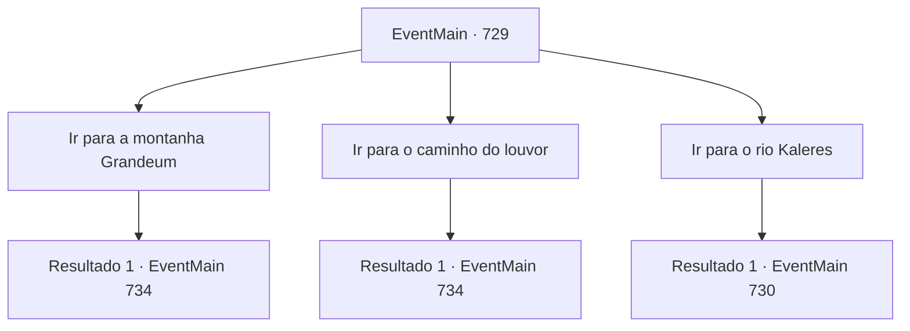

# Eventos principais · 729

[Índice da tabela](index.md) · [Índice geral](../index.md)

ID: `pt:EventMain:729` · Fonte: `EventMain4` · Versão: 1.2.47.

Mapeamento estático dos arquivos; a disponibilidade e a execução dependem do estado da run.

## Texto do evento

*Sem texto no arquivo.*

## Dados de entrada

```json
{
  "id": 729,
  "grade": 1,
  "normalGoal": "",
  "required": ""
}
```

## Mapa das escolhas



## Escolhas e resultados

### Escolha 1

Ir para a montanha Grandeum

Requisitos e outros campos da escolha:

```json
{
  "required": ""
}
```

#### Resultado 1.1

Você muda de rumo e lidera os adoradores até o Monte Grandeum.  

 Alguns dias depois, quando você chega ao Monte Grandeum, você persegue as pegadas da carruagem.  Felizmente, tinha chovido há pouco tempo e havia pegadas claras da carruagem passando no chão.  Você segue o rastro da carruagem no caminho da montanha.  Logo depois, você encontra uma carruagem parada na lama.  

 "Eles são adoradores de demônios! Mate todos eles!"

  Naquele exato momento, de repente, os paladinos saem correndo da carruagem e começam a atacar os adoradores.  Eles estão muito calmos, como se soubessem que seriam atacados.

Continuação registrada: [Evento 734](0734.md) na mesma tabela.

```json
{
  "required": "",
  "chance": "1",
  "nextEvent": 734,
  "type": 2,
  "reward": "6_3_50",
  "place": 1
}
```

### Escolha 2

Ir para o caminho do louvor

Requisitos e outros campos da escolha:

```json
{
  "required": ""
}
```

#### Resultado 2.1

Você muda de rumo e conduz adoradores ao caminho do louvor. 

 Alguns dias depois, quando você chega ao caminho do louvor, você persegue as pegadas da carruagem. Felizmente, tinha chovido há algum tempo e havia claras marcas da passagem da carruagem no chão. Você segue o rastro da carruagem na estrada. Logo em seguida, você encontra uma carruagem parada na lama. 

 "Eles são adoradores de demônios! Mate todos eles!"

 Naquele exato momento, de repente, os paladinos saem correndo da carruagem e começam a atacar os adoradores. Eles estão muito calmos, como se soubessem que seriam atacados.

Continuação registrada: [Evento 734](0734.md) na mesma tabela.

```json
{
  "required": "",
  "chance": "1",
  "nextEvent": 734,
  "type": 2,
  "reward": "6_3_50",
  "place": 0
}
```

### Escolha 3

Ir para o rio Kaleres

Requisitos e outros campos da escolha:

```json
{
  "required": ""
}
```

#### Resultado 3.1

Você muda de curso e lidera os adoradores até o Rio Kaleres. 

 Alguns dias depois, quando você chega ao Rio Kaleres, você se esconde e olha ao redor. Então você encontra pessoas acampadas perto do rio, entre elas um homem que chama sua atenção. Ele é um homem mais velho em um sacerdócio vermelho ricamente bordado, com rugas profundas na testa e uma barba que cobre todo o seu rosto inferior. |drawing_publius| 

 "Esse é Pub, Publius"

 Você olhou para Gess com um aceno em concordância com sua explicação. Sem perceber você, Publius está conversando com os paladinos ao seu redor.

Continuação registrada: [Evento 730](0730.md) na mesma tabela.

```json
{
  "required": "",
  "chance": "1",
  "nextEvent": 730,
  "type": 2,
  "reward": ""
}
```

## Referências que chegam a este evento

- [Evento 728 · escolha 3 · resultado 1](0728.md#escolha-3)
