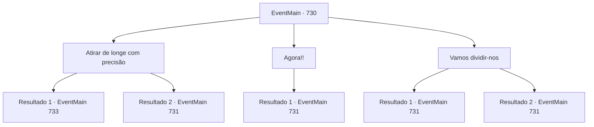

# Eventos principais · 730

[Índice da tabela](index.md) · [Índice geral](../index.md)

ID: `pt:EventMain:730` · Fonte: `EventMain4` · Versão: 1.2.47.

Mapeamento estático dos arquivos; a disponibilidade e a execução dependem do estado da run.

## Texto do evento

*Sem texto no arquivo.*

## Dados de entrada

```json
{
  "id": 730,
  "grade": 1,
  "normalGoal": "",
  "required": ""
}
```

## Mapa das escolhas



## Escolhas e resultados

### Escolha 1

Atirar de longe com precisão

Requisitos e outros campos da escolha:

```json
{
  "required": "20_6_1"
}
```

#### Resultado 1.1

Você atira em Publius. Incapaz de evitar o ataque repentino, ele desaba. Então, os paladinos sacam suas espadas e escudos e o cercam para protegê-lo. 

 "Protejam o arcebispo!"

 Você lidera os adoradores e avança contra eles.

Continuação registrada: [Evento 733](0733.md) na mesma tabela.

```json
{
  "required": "",
  "chance": "1|0_6_1",
  "nextEvent": 733,
  "type": 0,
  "reward": "6_2_149",
  "place": 8
}
```

#### Resultado 1.2

Você atira em Publius. Mas ele rapidamente se afasta do ataque. Então, os paladinos sacam suas espadas e escudos e o cercam para protegê-lo. 

 "Lá! Está voando ali! Todos, avancem!"

 "Pelo arcebispo!"

 Você lidera os adoradores e avança contra eles. Enquanto os paladinos estão avançando, Publius os ajuda lançando um feitiço. A luz brilhante que se espalha dele envolve os paladinos.

Continuação registrada: [Evento 731](0731.md) na mesma tabela.

```json
{
  "required": "",
  "chance": "30",
  "nextEvent": 731,
  "type": 1,
  "reward": "6_0_149",
  "place": 8
}
```

### Escolha 2

Agora!!

Requisitos e outros campos da escolha:

```json
{
  "required": ""
}
```

#### Resultado 2.1

Você se depara com adoradores de demônios. Então os paladinos rapidamente sacam suas espadas e se colocam em seu caminho. 

 "São adoradores de demônios! Protejam o Arcebispo!"

 Enquanto os paladinos estão avançando, Publius os auxilia lançando um feitiço. A luz brilhante que se espalha dele envolve os paladinos.

Continuação registrada: [Evento 731](0731.md) na mesma tabela.

```json
{
  "required": "",
  "chance": "1",
  "nextEvent": 731,
  "type": 2,
  "reward": "6_3_149",
  "place": 8
}
```

### Escolha 3

Vamos dividir-nos

Requisitos e outros campos da escolha:

```json
{
  "required": ""
}
```

#### Resultado 3.1

Você divide os adoradores em duas unidades, uma assume o papel de isca e a outra ataca o flanco. Primeiro, a primeira unidade faz um ataque surpresa nos paladinos. 

 "Eles são adoradores de demônios! Protejam o Arcebispo!"

 Enquanto os paladinos estão carregando, Publius os ajuda lançando um feitiço. A luz brilhante que se espalha dele envolve os paladinos. Os adoradores do papel de isca recuam, e os paladinos os seguem. Assim, sua formação se estende. E então, você lidera o restante dos adoradores e ataca o flanco da formação. 

 "É uma emboscada!"

 A formação dos paladinos, envergonhada pela emboscada, começa a se desorganizar.

Continuação registrada: [Evento 731](0731.md) na mesma tabela.

```json
{
  "required": "",
  "chance": "1|0_7_1",
  "nextEvent": 731,
  "type": 0,
  "reward": "6_2_149",
  "place": 8
}
```

#### Resultado 3.2

Você divide os adoradores em duas unidades, uma assume o papel de isca e a outra ataca o flanco. Primeiro, a primeira unidade faz um ataque surpresa nos paladinos. 

 "Eles são adoradores de demônios! Protejam o Arcebispo!"

 Enquanto os paladinos estão carregando, Publius os ajuda lançando um feitiço. A luz brilhante que se espalha dele envolve os paladinos. No entanto, antes que possam ser atraídos, alguns adoradores que não entendem a operação fogem. 

 "São reforços do inimigo!"

 Eventualmente, você os enfrenta de frente.

Continuação registrada: [Evento 731](0731.md) na mesma tabela.

```json
{
  "required": "",
  "chance": "18",
  "nextEvent": 731,
  "type": 1,
  "reward": "6_0_149",
  "place": 8
}
```

## Referências que chegam a este evento

- [Evento 729 · escolha 3 · resultado 1](0729.md#escolha-3)
- [Evento 827 · escolha 2 · resultado 1](0827.md#escolha-2)
