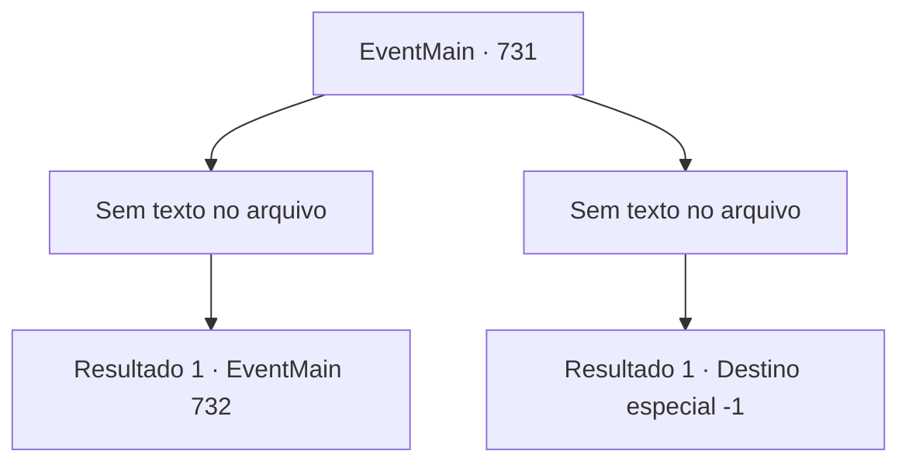

# Eventos principais · 731

[Índice da tabela](index.md) · [Índice geral](../index.md)

ID: `pt:EventMain:731` · Fonte: `EventMain4` · Versão: 1.2.47.

Mapeamento estático dos arquivos; a disponibilidade e a execução dependem do estado da run.

## Texto do evento

*Sem texto no arquivo.*

## Dados de entrada

```json
{
  "id": 731,
  "grade": 1,
  "normalGoal": "",
  "required": ""
}
```

## Mapa das escolhas



## Escolhas e resultados

### Escolha 1

*Sem texto no arquivo; o papel dessa opção depende da interface do jogo.*

Requisitos e outros campos da escolha:

```json
{
  "required": ""
}
```

#### Resultado 1.1

Os Cavaleiros caem como folhas de outono diante da sua força avassaladora. 

 "Kh... Luz!"

 Publius lança um feitiço e traz uma luz poderosa à medida que a situação se torna cada vez mais desfavorável. A luz é suficiente para bloquear sua visão por um momento. Logo após abrir os olhos, você vê uma figura de Publius correndo para longe.

Continuação registrada: [Evento 732](0732.md) na mesma tabela.

```json
{
  "required": "",
  "chance": "1",
  "nextEvent": 732,
  "type": 2,
  "reward": ""
}
```

### Escolha 2

*Sem texto no arquivo; o papel dessa opção depende da interface do jogo.*

Requisitos e outros campos da escolha:

```json
{
  "required": ""
}
```

#### Resultado 2.1

Quando você se ajoelhou diante do poderoso mágico Publius, os adoradores também foram aniquilados pelos Cavaleiros dos Santos Cavaleiros. Você não pode pedir ajuda a alguém. Você não pode fugir. É uma derrota completa. 

 "... Arraste-o. Tivemos sorte de vencer desta vez, mas tenho certeza de que é perigoso, então não baixe a guarda."

 Quando Publius dá ordens, os paladinos se aproximam de você e o algemam. Você é arrastado pelos paladinos, gritando: 'por que você matou minha família'. Mas não há resposta de Publius. Ele balança a cabeça. Então você é jogado na prisão sem saber de nada.

Continuação registrada: [Destino especial `-1`](../destinos-especiais.md).

```json
{
  "required": "",
  "chance": "1",
  "nextEvent": -1,
  "type": 2,
  "reward": "0_0_-1|0_1_-1|15_5_2|15_5_13|15_5_17"
}
```

## Referências que chegam a este evento

- [Evento 730 · escolha 1 · resultado 2](0730.md#escolha-1)
- [Evento 730 · escolha 2 · resultado 1](0730.md#escolha-2)
- [Evento 730 · escolha 3 · resultado 1](0730.md#escolha-3)
- [Evento 730 · escolha 3 · resultado 2](0730.md#escolha-3)
