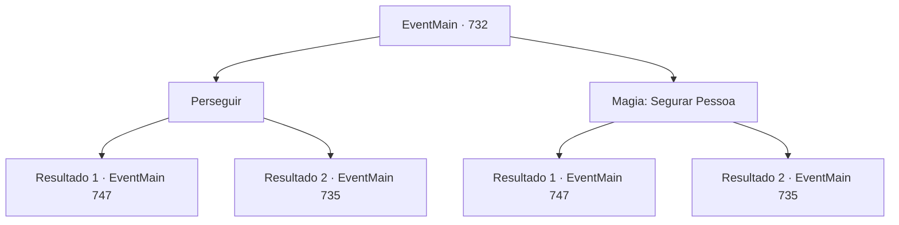

# Eventos principais · 732

[Índice da tabela](index.md) · [Índice geral](../index.md)

ID: `pt:EventMain:732` · Fonte: `EventMain4` · Versão: 1.2.47.

Mapeamento estático dos arquivos; a disponibilidade e a execução dependem do estado da run.

## Texto do evento

*Sem texto no arquivo.*

## Dados de entrada

```json
{
  "id": 732,
  "grade": 1,
  "normalGoal": "",
  "required": ""
}
```

## Mapa das escolhas



## Escolhas e resultados

### Escolha 1

Perseguir

Requisitos e outros campos da escolha:

```json
{
  "required": ""
}
```

#### Resultado 1.1

Você rapidamente persegue e pega Publius. Enquanto ele corre o mais rápido que pode, ele não consegue superar a inércia e cai quando você o agarra. Com um baque, ele rola no chão lamacento. Você se aproxima de Publius na poeira. Ele pergunta com um fôlego pesado. 

 "Ofegante... Você... Quem é você? Por que... você faz isso?"


Continuação registrada: [Evento 747](0747.md) na mesma tabela.

```json
{
  "required": "",
  "chance": "1|0_6_1",
  "nextEvent": 747,
  "type": 0,
  "reward": ""
}
```

#### Resultado 1.2

Você corre rapidamente atrás de Publius, mas acaba perdendo ele. Eventualmente, você retorna para onde a batalha aconteceu e se junta aos adoradores.

 Quando você retorna para o rio, o vencedor já está decidido. Os paladinos estavam mortos e os adoradores sobreviventes estavam descansando. Nesse momento, Gess vem correndo com o rosto pálido e coloca um monte de papel em suas mãos. 

 "Grande problema!"

 Você recebe um monte de papel e lê o conteúdo. O texto pede apoio da sede Teretiana do Reino de Puatu. O número é de até 5.000. E o objetivo é punir você e os adoradores de demônios. 

 "Será perigoso se reforços chegarem. O que você faria?"


Continuação registrada: [Evento 735](0735.md) na mesma tabela.

```json
{
  "required": "",
  "chance": "16",
  "nextEvent": 735,
  "type": 1,
  "reward": ""
}
```

### Escolha 2

Magia: Segurar Pessoa

Requisitos e outros campos da escolha:

```json
{
  "required": "20_0_3|1_1_2"
}
```

#### Resultado 2.1

Você rapidamente conjura Imobilizar Pessoa e pega Publius. Enquanto ele corre o mais rápido que pode, ele não consegue superar a inércia e cai quando você o agarra. Com um baque, ele rola no chão enlameado. Você se aproxima de Publius na poeira. Ele pergunta com um fôlego pesado. 

 "Ofegante... Você... Quem é você? Por que... você faz isso?"


Continuação registrada: [Evento 747](0747.md) na mesma tabela.

```json
{
  "required": "",
  "chance": "1|0_7_1",
  "nextEvent": 747,
  "type": 0,
  "reward": "0_1_-1"
}
```

#### Resultado 2.2

Você conjura Hold Person rapidamente, mas Publius cancela a magia e foge. Eventualmente, você retorna ao local onde a batalha ocorreu e se junta aos adoradores.

 Quando você volta para o rio, o vencedor já está decidido. Os paladinos estavam mortos e os adoradores sobreviventes estavam descansando. Nesse momento, Gess vem correndo com o rosto pálido e coloca um monte de papel em suas mãos. 

 "Grande problema!"

 Você recebe um monte de papel e lê o conteúdo. O texto pede apoio da sede Teretiana do Reino de Puatu. O número é de até 5.000. E o objetivo é punir você e os adoradores de demônios. 

 "Pode ser perigoso se reforços chegarem. O que você faria?"


Continuação registrada: [Evento 735](0735.md) na mesma tabela.

```json
{
  "required": "",
  "chance": "16",
  "nextEvent": 735,
  "type": 1,
  "reward": "0_1_-1"
}
```

## Referências que chegam a este evento

- [Evento 731 · escolha 1 · resultado 1](0731.md#escolha-1)
