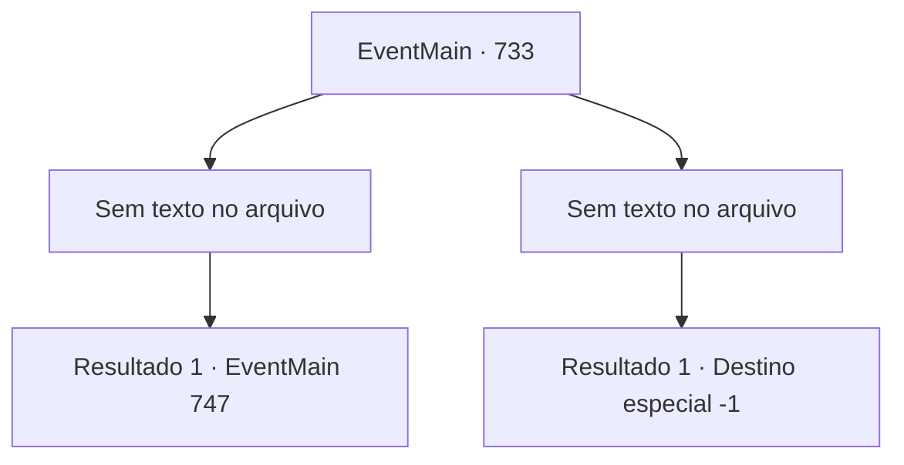

# Eventos principais · 733

[Índice da tabela](index.md) · [Índice geral](../index.md)

ID: `pt:EventMain:733` · Fonte: `EventMain4` · Versão: 1.2.47.

Mapeamento estático dos arquivos; a disponibilidade e a execução dependem do estado da run.

## Texto do evento

*Sem texto no arquivo.*

## Dados de entrada

```json
{
  "id": 733,
  "grade": 1,
  "normalGoal": "",
  "required": ""
}
```

## Mapa das escolhas



## Escolhas e resultados

### Escolha 1

*Sem texto no arquivo; o papel dessa opção depende da interface do jogo.*

Requisitos e outros campos da escolha:

```json
{
  "required": ""
}
```

#### Resultado 1.1

Você mata todos os paladinos e se aproxima do caído Publius. Então Publius abre os olhos, mal conseguindo respirar e olhando ao redor. 

 "Oh meu Deus..."

 Ele olha para você, exausto. 

 "Quem... diabos você é? Por que você faria isso..?"


Continuação registrada: [Evento 747](0747.md) na mesma tabela.

```json
{
  "required": "",
  "chance": "1",
  "nextEvent": 747,
  "type": 2,
  "reward": ""
}
```

### Escolha 2

*Sem texto no arquivo; o papel dessa opção depende da interface do jogo.*

Requisitos e outros campos da escolha:

```json
{
  "required": ""
}
```

#### Resultado 2.1

Quando você se ajoelha, a cabeça de Gess chama sua atenção. Ela perdeu o corpo e está rolando no chão. Os paladinos te seguram com força e te levam até Publius, que recobrou a consciência. Publius te olha e fala em voz baixa. 

 "... Arraste-o. Tivemos sorte de vencer desta vez, mas tenho certeza de que é perigoso, então não baixe a guarda."

 Quando Publius dá ordens, os paladinos se aproximam de você e te algemam. Você é arrastado pelos paladinos, gritando: 'por que você matou minha família.' Mas não há resposta de Publius. Ele balança a cabeça. Então você é jogado na prisão sem saber de nada.

Continuação registrada: [Destino especial `-1`](../destinos-especiais.md).

```json
{
  "required": "",
  "chance": "1",
  "nextEvent": -1,
  "type": 2,
  "reward": "0_0_-1|0_1_-1|15_5_2|15_5_13|15_5_17"
}
```

## Referências que chegam a este evento

- [Evento 730 · escolha 1 · resultado 1](0730.md#escolha-1)
