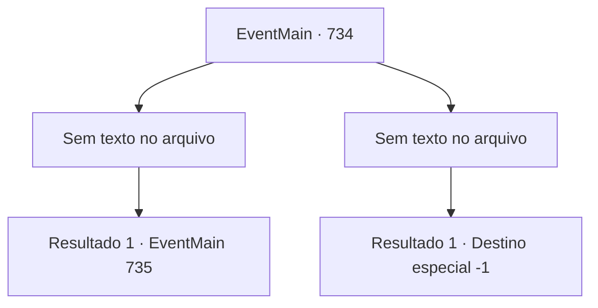

# Eventos principais · 734

[Índice da tabela](index.md) · [Índice geral](../index.md)

ID: `pt:EventMain:734` · Fonte: `EventMain4` · Versão: 1.2.47.

Mapeamento estático dos arquivos; a disponibilidade e a execução dependem do estado da run.

## Texto do evento

*Sem texto no arquivo.*

## Dados de entrada

```json
{
  "id": 734,
  "grade": 1,
  "normalGoal": "",
  "required": ""
}
```

## Mapa das escolhas



## Escolhas e resultados

### Escolha 1

*Sem texto no arquivo; o papel dessa opção depende da interface do jogo.*

Requisitos e outros campos da escolha:

```json
{
  "required": ""
}
```

#### Resultado 1.1

A batalha contra os paladinos termina com uma vitória para você e os adoradores. Você captura um paladino e pede a Gess para obter informações dele. 

 "Lea, deixe comigo. Huh, huh"

 Gess realiza uma tortura cruel no paladino com um sorriso sombrio. O paladino luta em dor e eventualmente confessa o que sabe. 

 "É tarde demais. O Arcebispo foi a esta igreja no Reino de Puatu em busca de apoio. Quando os reforços chegarem, você está acabado."

 Gess pergunta a você com uma expressão séria. 

 "Vai ser perigoso se os reforços chegarem. O que você faria?"


Continuação registrada: [Evento 735](0735.md) na mesma tabela.

```json
{
  "required": "",
  "chance": "1",
  "nextEvent": 735,
  "type": 2,
  "reward": ""
}
```

### Escolha 2

*Sem texto no arquivo; o papel dessa opção depende da interface do jogo.*

Requisitos e outros campos da escolha:

```json
{
  "required": ""
}
```

#### Resultado 2.1


 "Sim!"

 Você não consegue responder e é atingido diretamente por um ataque de paladino com um martelo gigante. Você perde a consciência por causa do grande choque. Num piscar de olhos, a escuridão chega.

Continuação registrada: [Destino especial `-1`](../destinos-especiais.md).

```json
{
  "required": "",
  "chance": "1",
  "nextEvent": -1,
  "type": 2,
  "reward": "15_5_2|15_5_13"
}
```

## Referências que chegam a este evento

- [Evento 729 · escolha 1 · resultado 1](0729.md#escolha-1)
- [Evento 729 · escolha 2 · resultado 1](0729.md#escolha-2)
