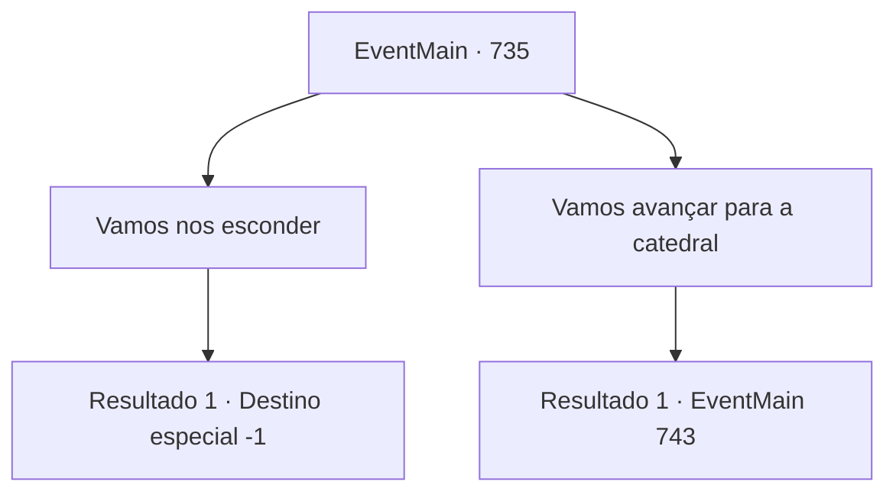

# Eventos principais · 735

[Índice da tabela](index.md) · [Índice geral](../index.md)

ID: `pt:EventMain:735` · Fonte: `EventMain4` · Versão: 1.2.47.

Mapeamento estático dos arquivos; a disponibilidade e a execução dependem do estado da run.

## Texto do evento

*Sem texto no arquivo.*

## Dados de entrada

```json
{
  "id": 735,
  "grade": 1,
  "normalGoal": "",
  "required": ""
}
```

## Mapa das escolhas



## Escolhas e resultados

### Escolha 1

Vamos nos esconder

Requisitos e outros campos da escolha:

```json
{
  "required": ""
}
```

#### Resultado 1.1

Depois de pensar por muito tempo, você decide se esconder. Mas você não está desistindo da vingança. Você está apenas recuando para buscar oportunidades de vingança que virão um dia. 

 "Então, então vá, vá."

 Gess pega uma carruagem com a marca de Teretian e começa a conduzi-la.

Continuação registrada: [Destino especial `-1`](../destinos-especiais.md).

```json
{
  "required": "",
  "chance": "1",
  "nextEvent": -1,
  "type": 2,
  "reward": "15_5_18"
}
```

### Escolha 2

Vamos avançar para a catedral

Requisitos e outros campos da escolha:

```json
{
  "required": ""
}
```

#### Resultado 2.1

Depois de pensar por muito tempo, você decide avançar para a Catedral de Yerut. Gess acena com a cabeça e segue seus passos com adoradores feridos.

 Quanto tempo se passou desde então? Finalmente, você chega perto de Regirique e olha para a cidade com os adoradores. A cidade é cercada por três muralhas. Há um número enorme de Paladinos guardando-a. Também há Publius, que fugiu da última vez. Ele encontra você e os adoradores, levanta sua bengala e grita com todas as suas forças. 

 "Enfrentem as forças do mal!"

 Com o grito, os portões se abrem e os paladinos a cavalo se aproximam de você e dos adoradores. Aqueles na frente estão vestidos com armaduras brancas e têm alabardas decoradas com ouro. 

 "Si, sigam o con, contratante!"

 Quando Gess grita, os adoradores gritam e cada um deles pega uma arma. Você lidera os adoradores na batalha com o exército.

Continuação registrada: [Evento 743](0743.md) na mesma tabela.

```json
{
  "required": "",
  "chance": "1",
  "nextEvent": 743,
  "type": 2,
  "reward": "6_3_149",
  "place": 0
}
```

## Referências que chegam a este evento

- [Evento 732 · escolha 1 · resultado 2](0732.md#escolha-1)
- [Evento 732 · escolha 2 · resultado 2](0732.md#escolha-2)
- [Evento 734 · escolha 1 · resultado 1](0734.md#escolha-1)
