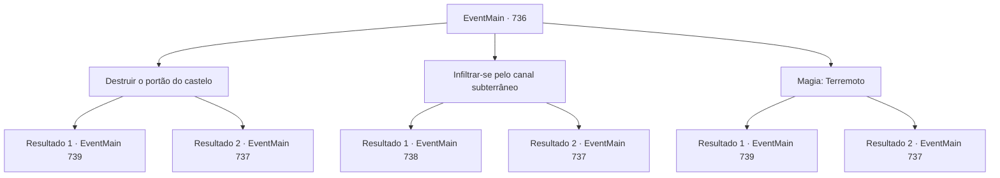

# Eventos principais · 736

[Índice da tabela](index.md) · [Índice geral](../index.md)

ID: `pt:EventMain:736` · Fonte: `EventMain4` · Versão: 1.2.47.

Mapeamento estático dos arquivos; a disponibilidade e a execução dependem do estado da run.

## Texto do evento

*Sem texto no arquivo.*

## Dados de entrada

```json
{
  "id": 736,
  "grade": 1,
  "normalGoal": "",
  "required": ""
}
```

## Mapa das escolhas



## Escolhas e resultados

### Escolha 1

Destruir o portão do castelo

Requisitos e outros campos da escolha:

```json
{
  "required": "20_9_2|5_414_0"
}
```

#### Resultado 1.1

Você escolhe o método padrão. Você avança em direção ao portão com adoradores. Os Paladinos que testemunharam isso atiram flechas na parede, mas você levanta o escudo e bloqueia.

 'Thud! Thud! Thud..! Bang!'

 Você arromba o portão com uma força tremenda e entra. E então você vê os paladinos recuando com expressões assustadas. 

 "Siga, siga o contratante!!"

 Com os gritos de alegria, os adoradores entram no Regirique. Você os ataca passando pelos paladinos assustados.

Continuação registrada: [Evento 739](0739.md) na mesma tabela.

```json
{
  "required": "",
  "chance": "1|0_5_1",
  "nextEvent": 739,
  "type": 0,
  "reward": "6_0_149",
  "place": 4
}
```

#### Resultado 1.2

Você escolhe o método padrão. Você avança no portão com adoradores. Os Paladinos que testemunharam isso atiram flechas na parede, mas você levanta o escudo e bloqueia.

 'Thud! Thud! Thud...!'

 Você tenta quebrar o portão várias vezes, mas ele não se quebra facilmente. Enquanto isso, as flechas continuam caindo e você recua. Assim o tempo passa e a noite chega.

Continuação registrada: [Evento 737](0737.md) na mesma tabela.

```json
{
  "required": "",
  "chance": "18",
  "nextEvent": 737,
  "type": 1,
  "reward": "5_414_1"
}
```

### Escolha 2

Infiltrar-se pelo canal subterrâneo

Requisitos e outros campos da escolha:

```json
{
  "required": "5_415_0"
}
```

#### Resultado 2.1

Gess aplaude e aceita sua sugestão. 

 "Ah, essa é uma boa, boa ideia"

 Ele encontra um canal de água ordenando seu Familiar, o rato de esgoto. Após cerca de uma hora, o rato de esgoto de Gess retorna. Ele sussurra algo no ouvido de Gess, e ele abre a boca. 

 "Ah, deixe-me gu, guiar você. Por aqui."

 Você segue Gess para o canal subterrâneo de água de Regirique. É muito escuro, cheira terrivelmente mal e contém sujeira nojenta. Você nada pelos canais subterrâneos com paciência. Felizmente, a estrutura do próprio canal é simples, então não demora muito para chegar à barreira. Ao percorrer um longo caminho, você vê uma porta fechada no teto.

Continuação registrada: [Evento 738](0738.md) na mesma tabela.

```json
{
  "required": "",
  "chance": "1|0_13_1",
  "nextEvent": 738,
  "type": 0,
  "reward": ""
}
```

#### Resultado 2.2

Gess aplaude e aceita sua sugestão. 

 "Ah, essa é uma boa, boa ideia"

 Ele encontra um canal de água ao ordenar seu Familiar, o rato de esgoto. Após cerca de uma hora, o rato de esgoto de Gess retorna. Ele sussurra algo no ouvido de Gess, e ele abre a boca. 

 "Ah, deixe-me gu, guiar você. Por aqui."

 Você segue Gess para o canal subterrâneo de água de Regirique. É muito escuro, cheira terrivelmente mal e contém sujeira nojenta. Você suporta o cheiro desagradável e olha ao redor da outra entrada, mas não consegue encontrá-la e a deixa para trás. Enquanto pensa em outras maneiras, a noite chega à medida que o tempo passa.

Continuação registrada: [Evento 737](0737.md) na mesma tabela.

```json
{
  "required": "",
  "chance": "14",
  "nextEvent": 737,
  "type": 1,
  "reward": "5_415_1"
}
```

### Escolha 3

Magia: Terremoto

Requisitos e outros campos da escolha:

```json
{
  "required": "20_0_4|1_1_2|5_416_0"
}
```

#### Resultado 3.1

É um ataque à noite quando os padres estão descansando. Você lança a magia do Terremoto em direção ao chão do portão. Alguns padres guardavam as paredes, Mas eles falham em bloquear sua magia, e partes das paredes e do portão são destruídas. 

'Kuuuuuuhhhh! Bang...!'

 Após confirmar que o portão estava quebrado, você avança em direção aos adoradores. 

 "Fol, Siga o con, contratante!!"

 Com o grito de Gess, os adoradores te seguem com um grito. Enquanto isso, você encontra os paladinos que estão prontos para a batalha e os ataca.

Continuação registrada: [Evento 739](0739.md) na mesma tabela.

```json
{
  "required": "",
  "chance": "1|0_7_1|0_12_1",
  "nextEvent": 739,
  "type": 0,
  "reward": "6_0_149|0_1_-1",
  "place": 4
}
```

#### Resultado 3.2

Você conjura a magia do Terremoto em direção ao chão do portão. Mas os sacerdotes que guardavam as paredes destroem sua magia. Sua tentativa falha. Eventualmente, você desiste por enquanto.

Continuação registrada: [Evento 737](0737.md) na mesma tabela.

```json
{
  "required": "",
  "chance": "36",
  "nextEvent": 737,
  "type": 1,
  "reward": "0_1_-1|5_416_1"
}
```

## Referências que chegam a este evento

- [Evento 728 · escolha 2 · resultado 1](0728.md#escolha-2)
- [Evento 826 · escolha 2 · resultado 1](0826.md#escolha-2)
