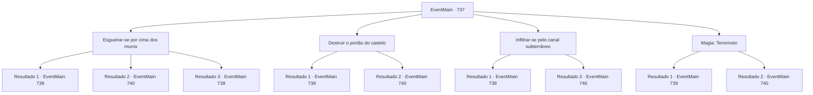

# Eventos principais · 737

[Índice da tabela](index.md) · [Índice geral](../index.md)

ID: `pt:EventMain:737` · Fonte: `EventMain4` · Versão: 1.2.47.

Mapeamento estático dos arquivos; a disponibilidade e a execução dependem do estado da run.

## Texto do evento

*Sem texto no arquivo.*

## Dados de entrada

```json
{
  "id": 737,
  "grade": 1,
  "normalGoal": "",
  "required": ""
}
```

## Mapa das escolhas



## Escolhas e resultados

### Escolha 1

Esgueirar-se por cima dos muros

Requisitos e outros campos da escolha:

```json
{
  "required": ""
}
```

#### Resultado 1.1

Aproveitas a escuridão que a noite traz. Aproximas-te secretamente da parede e escalas com as tuas mãos nuas. As paredes são escassamente guardadas pelos paladinos, mas são poucos. Depois de subir a parede com dificuldade, aproximas-te do portão do castelo, evitando o olhar dos paladinos. E abres a porta e sinalizas aos adoradores. 

 "Sigam, sigam o contratante!!"

 Com os gritos de Ges, os adoradores gritam e entram no Regirique. Os paladinos, que perceberam tarde demais que o portão estava aberto, correm em tua direção e em direção aos adoradores.

Continuação registrada: [Evento 739](0739.md) na mesma tabela.

```json
{
  "required": "21_5_3",
  "chance": "1|0_6_1",
  "nextEvent": 739,
  "type": 0,
  "reward": "6_0_149",
  "place": 4
}
```

#### Resultado 1.2

Você aproveita a escuridão que a noite traz. Você se aproxima secretamente da parede e a escala com as mãos nuas. Mas mesmo à noite, o plano falha por causa da forte guarda dos Paladinos. 

 "O inimigo está na parede!"

 Você rapidamente foge dali com a chuva de flechas.

Continuação registrada: [Evento 740](0740.md) na mesma tabela.

```json
{
  "required": "21_5_3",
  "chance": "16",
  "nextEvent": 740,
  "type": 1,
  "reward": ""
}
```

#### Resultado 1.3

Aproveitas a escuridão que a noite traz. É o teu talento para entrar sorrateiramente. Sobes secretamente pelas paredes sem que ninguém perceba. As paredes são pouco vigiadas pelos paladinos, mas são poucos. Ao subir a parede, te aproximas do portão, evitando o olhar dos paladinos. E abres a porta e sinalizas para os adoradores. 

 "Fol, Siga o con, contratante!!"

 Com os gritos de Ges, os adoradores gritam e entram no Regirique. Os paladinos, que perceberam tardiamente que o portão estava aberto, correm em sua direção e em direção aos adoradores.

Continuação registrada: [Evento 739](0739.md) na mesma tabela.

```json
{
  "required": "20_5_3",
  "chance": "1",
  "nextEvent": 739,
  "type": 2,
  "reward": "6_0_149",
  "place": 4
}
```

### Escolha 2

Destruir o portão do castelo

Requisitos e outros campos da escolha:

```json
{
  "required": "20_9_2|5_414_0"
}
```

#### Resultado 2.1

Você decide aproveitar a noite. É um ataque surpresa ao portão durante a noite, quando os Paladinos estão descansando. Você avança no portão com adoradores. Os Paladinos que testemunharam isso atiram flechas na parede, mas não conseguem parar seu avanço.

 'Thud! Thud! Thud..! Bang!' 

 Você arromba o portão com uma força tremenda e entra. E então você vê os paladinos recuando com expressões assustadas. 

 "Siga, siga o contratante!!"

 Com os gritos de alegria, os adoradores entram em Regirique. Você os ataca passando pelos paladinos assustados.

Continuação registrada: [Evento 739](0739.md) na mesma tabela.

```json
{
  "required": "",
  "chance": "1|0_5_1",
  "nextEvent": 739,
  "type": 0,
  "reward": "6_0_149",
  "place": 4
}
```

#### Resultado 2.2

Você decide aproveitar a noite. É um ataque surpresa ao portão durante a noite, quando os Paladinos estão descansando. Você avança no portão com adoradores. Os Paladinos que testemunharam isso atiram flechas na parede, mas não conseguem parar seu avanço.

 'Thud! Thud! Thud...!' 

 Você tenta quebrar o portão várias vezes, mas ele não se quebra facilmente. Enquanto isso, as flechas continuam caindo e você recua.


Continuação registrada: [Evento 740](0740.md) na mesma tabela.

```json
{
  "required": "",
  "chance": "16",
  "nextEvent": 740,
  "type": 1,
  "reward": ""
}
```

### Escolha 3

Infiltrar-se pelo canal subterrâneo

Requisitos e outros campos da escolha:

```json
{
  "required": "18_415_1"
}
```

#### Resultado 3.1

Gess aplaude e aceita sua sugestão. 

 "Ah, essa é uma boa, boa ideia"

 Ele encontra um canal de água ordenando seu Familiar, o rato de esgoto. Após cerca de uma hora, o rato de esgoto de Gess retorna. Ele sussurra algo no ouvido de Gess, e ele abre a boca. 

 "Ah, deixe-me gu, guiar você. Por aqui."

 Você segue Gess para o canal subterrâneo de água de Regirique. É muito escuro, cheira terrivelmente mal e contém sujeira nojenta. Você nada pelos canais subterrâneos com paciência. Felizmente, a estrutura do próprio canal é simples, então não demora muito para chegar à barreira. Ao percorrer um longo caminho, você vê uma porta fechada no teto.

Continuação registrada: [Evento 738](0738.md) na mesma tabela.

```json
{
  "required": "",
  "chance": "1|0_13_1",
  "nextEvent": 738,
  "type": 0,
  "reward": ""
}
```

#### Resultado 3.2

Gess aplaude e aceita sua sugestão. 

 "Ah, essa é uma boa, boa ideia"

 Ele encontra um canal de água ao ordenar seu Familiar, o rato de esgoto. Após cerca de uma hora, o rato de esgoto de Gess retorna. Ele sussurra algo no ouvido de Gess, e ele abre a boca. 

 "Ah, deixe-me gu, guiar você. Por aqui."

 Você segue Gess para o canal subterrâneo de água de Regirique. É muito escuro, cheira terrivelmente mal e contém sujeira nojenta. Você suporta o cheiro desagradável e olha ao redor da outra entrada, mas não consegue encontrá-la e a deixa lá.

Continuação registrada: [Evento 740](0740.md) na mesma tabela.

```json
{
  "required": "",
  "chance": "14",
  "nextEvent": 740,
  "type": 1,
  "reward": ""
}
```

### Escolha 4

Magia: Terremoto

Requisitos e outros campos da escolha:

```json
{
  "required": "20_0_4|1_1_2|18_416_1"
}
```

#### Resultado 4.1

Você decide aproveitar a noite. É um ataque à noite, quando os padres estão descansando. Você lança a magia do Terremoto em direção ao chão do portão. Alguns padres guardavam as paredes à noite, Mas eles falham em bloquear sua magia, e partes das paredes e do portão são destruídas. 

'Kuuuuuuhhhh! Bang...!'

 Após confirmar que o portão estava quebrado, você avança contra os adoradores. 

 "Fol, Siga o contratante!!"

 Com o grito de Gess, os adoradores te seguem com um grito. Enquanto isso, você encontra os paladinos que estão prontos para a batalha e os ataca.

Continuação registrada: [Evento 739](0739.md) na mesma tabela.

```json
{
  "required": "",
  "chance": "1|0_7_1|0_12_1",
  "nextEvent": 739,
  "type": 0,
  "reward": "6_0_149|0_1_-1",
  "place": 4
}
```

#### Resultado 4.2

Você decide aproveitar a noite. É um ataque à noite, quando os sacerdotes estão descansando. Você lança a magia do Terremoto em direção ao solo do portão. Mas mesmo à noite, os sacerdotes que guardavam as paredes destroem sua magia. Sua tentativa falha. Eventualmente, você desiste por enquanto.

Continuação registrada: [Evento 740](0740.md) na mesma tabela.

```json
{
  "required": "",
  "chance": "32",
  "nextEvent": 740,
  "type": 1,
  "reward": "0_1_-1"
}
```

## Referências que chegam a este evento

- [Evento 736 · escolha 1 · resultado 2](0736.md#escolha-1)
- [Evento 736 · escolha 2 · resultado 2](0736.md#escolha-2)
- [Evento 736 · escolha 3 · resultado 2](0736.md#escolha-3)
