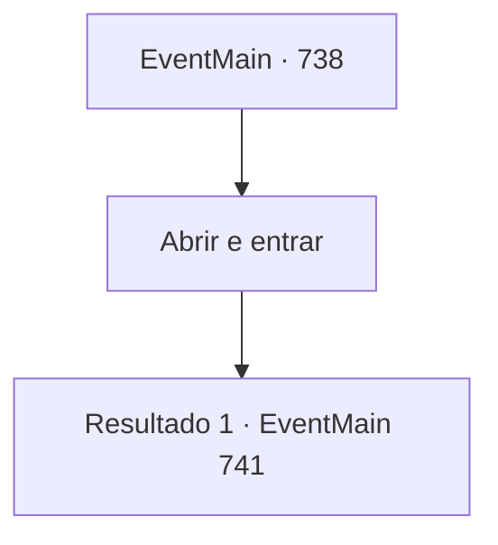

# Eventos principais · 738

[Índice da tabela](index.md) · [Índice geral](../index.md)

ID: `pt:EventMain:738` · Fonte: `EventMain4` · Versão: 1.2.47.

Mapeamento estático dos arquivos; a disponibilidade e a execução dependem do estado da run.

## Texto do evento

*Sem texto no arquivo.*

## Dados de entrada

```json
{
  "id": 738,
  "grade": 1,
  "normalGoal": "",
  "required": ""
}
```

## Mapa das escolhas



## Escolhas e resultados

### Escolha 1

Abrir e entrar

Requisitos e outros campos da escolha:

```json
{
  "required": ""
}
```

#### Resultado 1.1

Quando você abre a porta, você vê o interior da catedral. Há mármore branco, um tapete de tapetes, tetos altos e lustres coloridos. 

 "Inimigo! O inimigo está aqui!"

 Os Paladinos dentro dela vêm até você. Eles tocam trombetas douradas para chamar seus companheiros, e os Paladinos se apressam instantaneamente. 

 "Siga, siga o contratante!!"

 Você enfrenta-os puxando suas armas. E Gess e outros adoradores que o seguem para fora do canal se juntam à luta.

Continuação registrada: [Evento 741](0741.md) na mesma tabela.

```json
{
  "required": "",
  "chance": "1",
  "nextEvent": 741,
  "type": 2,
  "reward": "6_0_149",
  "place": 10
}
```

## Referências que chegam a este evento

- [Evento 736 · escolha 2 · resultado 1](0736.md#escolha-2)
- [Evento 737 · escolha 3 · resultado 1](0737.md#escolha-3)
