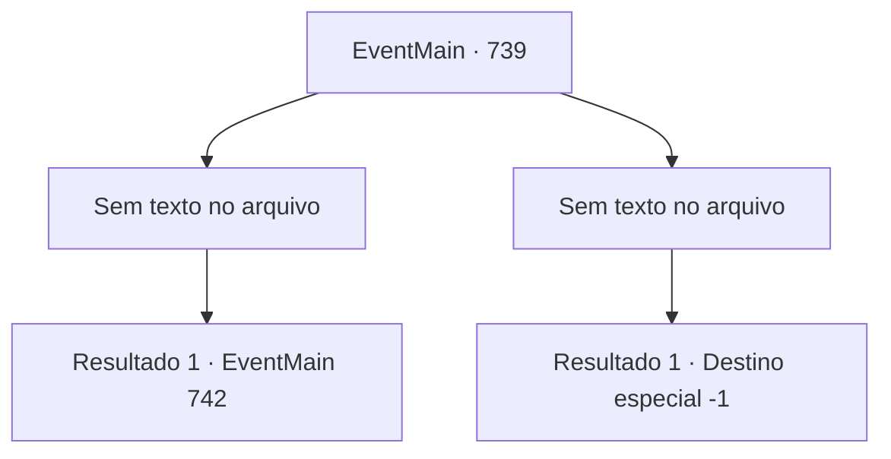

# Eventos principais · 739

[Índice da tabela](index.md) · [Índice geral](../index.md)

ID: `pt:EventMain:739` · Fonte: `EventMain4` · Versão: 1.2.47.

Mapeamento estático dos arquivos; a disponibilidade e a execução dependem do estado da run.

## Texto do evento

*Sem texto no arquivo.*

## Dados de entrada

```json
{
  "id": 739,
  "grade": 1,
  "normalGoal": "",
  "required": ""
}
```

## Mapa das escolhas



## Escolhas e resultados

### Escolha 1

*Sem texto no arquivo; o papel dessa opção depende da interface do jogo.*

Requisitos e outros campos da escolha:

```json
{
  "required": ""
}
```

#### Resultado 1.1

|drawing_tereCathedral| Você caminha pelas ruas manchadas de sangue de Regirique e entra na Catedral de Yerut. A Catedral de Yerut, construída no centro de Regirique, é um lugar espetacular. Todo o prédio é feito de mármore, com uma cúpula azul no topo, Por toda a parede externa há esculturas e mosaicos em homenagem aos santos. Você caminha por um corredor feito de mármore branco e entra no escritório de Publius. Mas você não vê nenhuma figura de Publius em lugar algum. Você olha através da mesa de Publius. E então você encontra um documento escrito nele pedindo apoio da Igreja Teretiana em outro país. São 5.000 pessoas, então os olhos de Gess se assustaram. Então, a voz de Kior é ouvida em sua cabeça. 

 "Você precisa da minha ajuda. {1}. Construa um altar e sacrifique os paladinos mortos. Então eu enviarei meus homens que não perderão nem mesmo para o exército."


Continuação registrada: [Evento 742](0742.md) na mesma tabela.

```json
{
  "required": "",
  "chance": "1",
  "nextEvent": 742,
  "type": 2,
  "reward": ""
}
```

### Escolha 2

*Sem texto no arquivo; o papel dessa opção depende da interface do jogo.*

Requisitos e outros campos da escolha:

```json
{
  "required": ""
}
```

#### Resultado 2.1

Os Paladinos no Regirique nem mesmo têm medo da morte. Em vez disso, eles se usam como escudos para proteger seus colegas e empunham uma espada contra você enquanto sangram. E nesse ataque desesperado, você acaba caindo.

Continuação registrada: [Destino especial `-1`](../destinos-especiais.md).

```json
{
  "required": "",
  "chance": "1",
  "nextEvent": -1,
  "type": 2,
  "reward": "0_0_-1|0_1_-1|15_5_2|15_5_13"
}
```

## Referências que chegam a este evento

- [Evento 736 · escolha 1 · resultado 1](0736.md#escolha-1)
- [Evento 736 · escolha 3 · resultado 1](0736.md#escolha-3)
- [Evento 737 · escolha 1 · resultado 1](0737.md#escolha-1)
- [Evento 737 · escolha 1 · resultado 3](0737.md#escolha-1)
- [Evento 737 · escolha 2 · resultado 1](0737.md#escolha-2)
- [Evento 737 · escolha 4 · resultado 1](0737.md#escolha-4)
