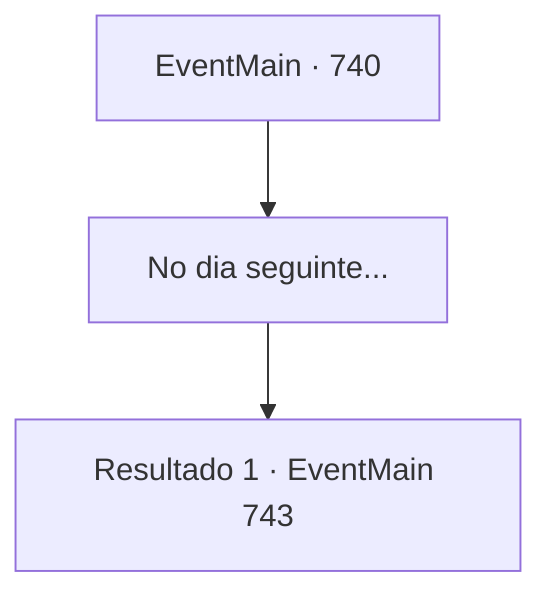

# Eventos principais · 740

[Índice da tabela](index.md) · [Índice geral](../index.md)

ID: `pt:EventMain:740` · Fonte: `EventMain4` · Versão: 1.2.47.

Mapeamento estático dos arquivos; a disponibilidade e a execução dependem do estado da run.

## Texto do evento

*Sem texto no arquivo.*

## Dados de entrada

```json
{
  "id": 740,
  "grade": 1,
  "normalGoal": "",
  "required": ""
}
```

## Mapa das escolhas



## Escolhas e resultados

### Escolha 1

No dia seguinte...

Requisitos e outros campos da escolha:

```json
{
  "required": ""
}
```

#### Resultado 1.1

No dia seguinte, você lidera os adoradores até as muralhas de Regirique. Mas então, com um grito alto, a terra começa a tremer. 

 "Mate o rebanho maligno!"

 Olhando para trás, tantos paladinos estão carregando a cavalo que você pode chamá-los de um exército. Seus cascos ecoam como trovões, e o eixo da terra treme. E o homem mais velho no uniforme vermelho de sacerdote os lidera. 

 "Pu, Publius!? A, Armadilha! F, Foi uma armadilha!?"

 Eles se aproximam rapidamente e começam a perfurar os adoradores.

Continuação registrada: [Evento 743](0743.md) na mesma tabela.

```json
{
  "required": "",
  "chance": "1",
  "nextEvent": 743,
  "type": 2,
  "reward": "6_3_149",
  "place": 0
}
```

## Referências que chegam a este evento

- [Evento 737 · escolha 1 · resultado 2](0737.md#escolha-1)
- [Evento 737 · escolha 2 · resultado 2](0737.md#escolha-2)
- [Evento 737 · escolha 3 · resultado 2](0737.md#escolha-3)
- [Evento 737 · escolha 4 · resultado 2](0737.md#escolha-4)
