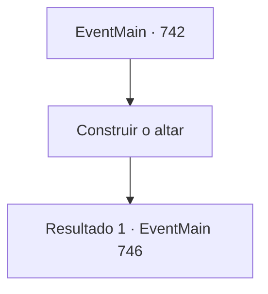

# Eventos principais · 742

[Índice da tabela](index.md) · [Índice geral](../index.md)

ID: `pt:EventMain:742` · Fonte: `EventMain4` · Versão: 1.2.47.

Mapeamento estático dos arquivos; a disponibilidade e a execução dependem do estado da run.

## Texto do evento

*Sem texto no arquivo.*

## Dados de entrada

```json
{
  "id": 742,
  "grade": 1,
  "normalGoal": "",
  "required": ""
}
```

## Mapa das escolhas



## Escolhas e resultados

### Escolha 1

Construir o altar

Requisitos e outros campos da escolha:

```json
{
  "required": ""
}
```

#### Resultado 1.1

Você diz a Gess para dar a voz a Kior e se apressar em construir um altar. Com esse comando, Gess constrói apressadamente um altar com adoradores. |drawing_DemonSummon| No dia seguinte, você está guardando a parede com o exército de demônios convocado. Nesse momento, a terra começa a tremer com um grito alto. 

 "Matem a horda do mal!"

 Olhando para trás, tantos paladinos estão carregando a cavalo que você pode chamá-los de um exército. Seus cascos ecoam como trovões e o eixo da terra treme. E o homem mais velho com o uniforme vermelho de sacerdote os lidera. 

 "Ali, ali! Publius está ali!"

 Na voz de Gess, você pode ver que a identidade do velho é 'Publius'. Eles se aproximam rapidamente e correm em direção à parede.

Continuação registrada: [Evento 746](0746.md) na mesma tabela.

```json
{
  "required": "",
  "chance": "1",
  "nextEvent": 746,
  "type": 2,
  "reward": "6_0_149",
  "place": 0
}
```

## Referências que chegam a este evento

- [Evento 739 · escolha 1 · resultado 1](0739.md#escolha-1)
- [Evento 741 · escolha 1 · resultado 1](0741.md#escolha-1)
