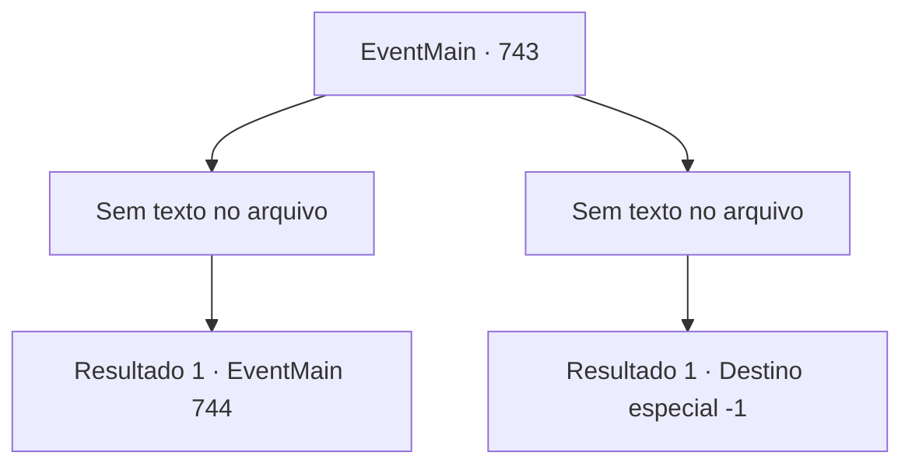

# Eventos principais · 743

[Índice da tabela](index.md) · [Índice geral](../index.md)

ID: `pt:EventMain:743` · Fonte: `EventMain4` · Versão: 1.2.47.

Mapeamento estático dos arquivos; a disponibilidade e a execução dependem do estado da run.

## Texto do evento

*Sem texto no arquivo.*

## Dados de entrada

```json
{
  "id": 743,
  "grade": 1,
  "normalGoal": "",
  "required": ""
}
```

## Mapa das escolhas



## Escolhas e resultados

### Escolha 1

*Sem texto no arquivo; o papel dessa opção depende da interface do jogo.*

Requisitos e outros campos da escolha:

```json
{
  "required": ""
}
```

#### Resultado 1.1

Você atravessa os Paladinos e se aproxima de Publius. Então, de repente, uma voz alta sai de Publius e te impede. 

 "Poderoso Tere! Por favor, abra a porta para expulsar o mal!"

 Há um grito alto vindo de Publius. Naquele momento, o espaço se distorce e uma força poderosa te atrai. E há uma voz assustada vinda de Kior. 

 "Desaparecimento... Parece que ele está tentando te jogar para outra dimensão. Segure-se em qualquer coisa!"

 Seu corpo começa a subir como se estivesse no meio de uma tempestade.

Continuação registrada: [Evento 744](0744.md) na mesma tabela.

```json
{
  "required": "",
  "chance": "1",
  "nextEvent": 744,
  "type": 2,
  "reward": ""
}
```

### Escolha 2

*Sem texto no arquivo; o papel dessa opção depende da interface do jogo.*

Requisitos e outros campos da escolha:

```json
{
  "required": ""
}
```

#### Resultado 2.1

Você tenta todos os tipos de métodos, mas não consegue vencer o exército de Tere no final. Publius se aproxima de você de joelhos e fala com uma voz fria. 

 "Eu perdi muitas coisas para você. Valen, Onil, Danica... É hora de pagar o preço."

 Sem tempo para refutar, você é levado para a prisão pelos Paladinos.

Continuação registrada: [Destino especial `-1`](../destinos-especiais.md).

```json
{
  "required": "",
  "chance": "1",
  "nextEvent": -1,
  "type": 2,
  "reward": "0_0_-1|0_1_-1|15_5_2|15_5_13|15_5_17"
}
```

## Referências que chegam a este evento

- [Evento 735 · escolha 2 · resultado 1](0735.md#escolha-2)
- [Evento 740 · escolha 1 · resultado 1](0740.md#escolha-1)
- [Evento 829 · escolha 1 · resultado 1](0829.md#escolha-1)
