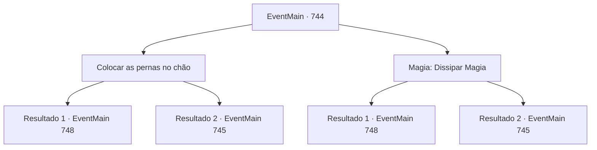

# Eventos principais · 744

[Índice da tabela](index.md) · [Índice geral](../index.md)

ID: `pt:EventMain:744` · Fonte: `EventMain4` · Versão: 1.2.47.

Mapeamento estático dos arquivos; a disponibilidade e a execução dependem do estado da run.

## Texto do evento

*Sem texto no arquivo.*

## Dados de entrada

```json
{
  "id": 744,
  "grade": 1,
  "normalGoal": "",
  "required": ""
}
```

## Mapa das escolhas



## Escolhas e resultados

### Escolha 1

Colocar as pernas no chão

Requisitos e outros campos da escolha:

```json
{
  "required": ""
}
```

#### Resultado 1.1

Você finca suas pernas no chão com tremenda força e se agarra a uma forte atração. Publius, que falhou em expulsá-lo, ofega e se ajoelha, Você se aproxima dele e o agarra pela cabeça. 

 "Arcebispo!"

 Os paladinos ficam surpresos e correm em sua direção, mas é tarde demais. Você leva a alma de Publius e lhe dá o fim. Logo em seguida, sua casca vazia desaba. 

 "A... Ah...! O arcebispo...!"

 Os paladinos, que testemunharam a cena, perdem seu espírito de luta. Você se livra deles e olha para a catedral manchada de sangue. Então, a risada de Kior chega aos seus ouvidos. 

 "Hahaha! Ótimo trabalho! {1}! Agora dedique suas almas a mim!!"

 Os paladinos, que testemunharam a cena, perdem seu espírito de luta e começam a fugir. Em contraste, o moral dos adoradores do demônio está nas alturas. Logo você ouve a voz satisfeita de Kior. 

 "Khahaha!!! Ótimo! É excelente! Bem, vou retribuir sua dedicação. Receba minha força. Vou lhe dar o poder que você nunca experimentou antes."

 E então, com esse poder, Ele ordena que você apague tudo sobre Tere.

Continuação registrada: [Evento 748](0748.md) na mesma tabela.

```json
{
  "required": "",
  "chance": "1|0_5_1",
  "nextEvent": 748,
  "type": 0,
  "reward": ""
}
```

#### Resultado 1.2

Você coloca suas pernas no chão e se segura a uma forte atração. Mas no final, você é atraído por uma enorme força e engolido por uma dimensão diferente. 

 Quando você de repente recobra os sentidos, você vê um espaço vazio à sua frente. É um lugar vazio, como se todas as estrelas tivessem sido apagadas do céu noturno. Você pergunta a Kior onde está. Logo sua voz chegou aos seus ouvidos. 

 "Oh não, não é bom. Parece que você está preso em uma lacuna na dimensão."

 De acordo com a explicação de Kior, você não faz parte de nenhuma dimensão, Está vagamente preso entre a lacuna nas dimensões. 

 "Agora que está assim, continuar sua vingança é difícil. Você fez um ótimo trabalho."

 No final da voz, a energia de Kior começa a desaparecer.

Continuação registrada: [Evento 745](0745.md) na mesma tabela.

```json
{
  "required": "",
  "chance": "20",
  "nextEvent": 745,
  "type": 1,
  "reward": ""
}
```

### Escolha 2

Magia: Dissipar Magia

Requisitos e outros campos da escolha:

```json
{
  "required": "20_0_2|1_1_2"
}
```

#### Resultado 2.1

Você rapidamente lança um Dispel para parar o Desaparecimento. Então você estende seu braço sombrio e agarra sua cabeça. 

 "Arcebispo!"

 Os paladinos estão surpresos e correm em sua direção, mas é tarde demais. Você leva a alma de Publius e lhe dá o fim. Logo em seguida, sua casca vazia desmorona. 

 "A... Ah...! O arcebispo...!"

 Os paladinos, que testemunharam a cena, perdem seu espírito de luta e começam a fugir. Em contraste, o moral dos adoradores do demônio está nas alturas. Logo você ouve a voz satisfeita de Kior. 

 "Khahaha!!! Ótimo! É excelente! Bem, vou retribuir sua dedicação. Receba minha força. Vou te dar o poder que você nunca experimentou antes."

 E então, com esse poder, Ele te ordena apagar tudo sobre Tere.

Continuação registrada: [Evento 748](0748.md) na mesma tabela.

```json
{
  "required": "",
  "chance": "1|0_7_1",
  "nextEvent": 748,
  "type": 0,
  "reward": "0_1_-1"
}
```

#### Resultado 2.2

Tentas parar o Desaparecimento rapidamente com o Dissipar. Mas o poder que te atrai engole-te mais rápido. Eventualmente, és engolido por uma dimensão diferente. 

 Quando de repente voltas a ti, vês um espaço vazio à tua frente. É um lugar vazio, como se todas as estrelas tivessem sido apagadas do céu negro da noite. Perguntas a Kior onde estás. Em breve, a sua voz chega aos teus ouvidos. 

 "Oh não, não é bom. Parece que estás preso numa lacuna na dimensão."

 De acordo com a explicação de Kior, não fazes parte de nenhuma dimensão, Estás vagamente preso entre a lacuna nas dimensões. 

 "Agora que é assim, continuar a tua vingança é difícil. Fizeste um ótimo trabalho."

 No final da voz, a energia de Kior começa a desvanecer-se.

Continuação registrada: [Evento 745](0745.md) na mesma tabela.

```json
{
  "required": "",
  "chance": "20",
  "nextEvent": 745,
  "type": 1,
  "reward": "0_1_-1"
}
```

## Referências que chegam a este evento

- [Evento 743 · escolha 1 · resultado 1](0743.md#escolha-1)
