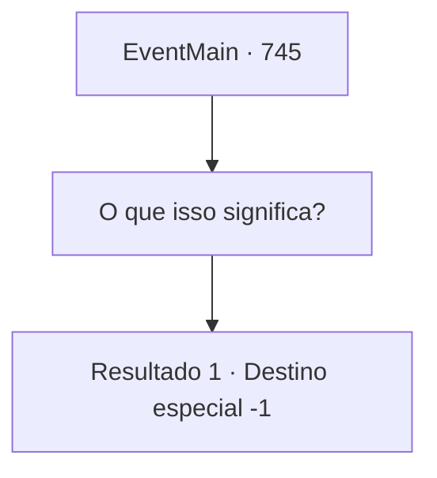

# Eventos principais · 745

[Índice da tabela](index.md) · [Índice geral](../index.md)

ID: `pt:EventMain:745` · Fonte: `EventMain4` · Versão: 1.2.47.

Mapeamento estático dos arquivos; a disponibilidade e a execução dependem do estado da run.

## Texto do evento

*Sem texto no arquivo.*

## Dados de entrada

```json
{
  "id": 745,
  "grade": 1,
  "normalGoal": "",
  "required": ""
}
```

## Mapa das escolhas



## Escolhas e resultados

### Escolha 1

O que isso significa?

Requisitos e outros campos da escolha:

```json
{
  "required": ""
}
```

#### Resultado 1.1

Você grita com Kior, 'O que isso significa?' Mas não há resposta de Kior. Em vez disso, a magia de Kior escapa do seu corpo e você rapidamente fica fraco. Você permanece sozinho na lacuna da dimensão.

Continuação registrada: [Destino especial `-1`](../destinos-especiais.md).

```json
{
  "required": "",
  "chance": "1",
  "nextEvent": -1,
  "type": 2,
  "reward": "15_5_11|15_5_13|15_5_17"
}
```

## Referências que chegam a este evento

- [Evento 744 · escolha 1 · resultado 2](0744.md#escolha-1)
- [Evento 744 · escolha 2 · resultado 2](0744.md#escolha-2)
