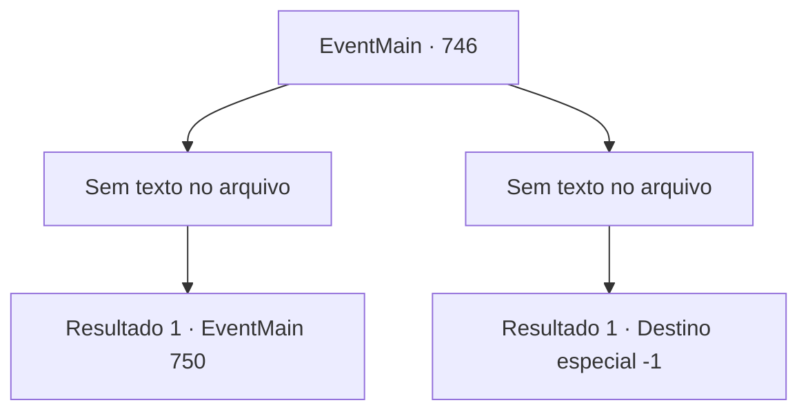

# Eventos principais · 746

[Índice da tabela](index.md) · [Índice geral](../index.md)

ID: `pt:EventMain:746` · Fonte: `EventMain4` · Versão: 1.2.47.

Mapeamento estático dos arquivos; a disponibilidade e a execução dependem do estado da run.

## Texto do evento

*Sem texto no arquivo.*

## Dados de entrada

```json
{
  "id": 746,
  "grade": 1,
  "normalGoal": "",
  "required": ""
}
```

## Mapa das escolhas



## Escolhas e resultados

### Escolha 1

*Sem texto no arquivo; o papel dessa opção depende da interface do jogo.*

Requisitos e outros campos da escolha:

```json
{
  "required": ""
}
```

#### Resultado 1.1

As portas são quebradas instantaneamente com o ataque dos Paladinos. Por causa disso, as paredes se tornam um caos, e os demônios e os paladinos começam a se misturar e matar uns aos outros. Você ataca os Paladinos com os demônios. Quebra suas armas, destroça suas armaduras e tira o fôlego deles. Devido à sua dança avassaladora, os demônios estão ficando cada vez mais vantajosos. Quanto tempo durou a batalha? Você esmaga todos os Paladinos que estão na sua frente e fica diante de Publius. Machucado pelos ataques dos demônios, Publius está apoiado em uma rocha. 

 "Te... Tere não irá te perdoar."

 Publius lança uma maldição a você, vomitando sangue.

Continuação registrada: [Evento 750](0750.md) na mesma tabela.

```json
{
  "required": "",
  "chance": "1",
  "nextEvent": 750,
  "type": 2,
  "reward": ""
}
```

### Escolha 2

*Sem texto no arquivo; o papel dessa opção depende da interface do jogo.*

Requisitos e outros campos da escolha:

```json
{
  "required": ""
}
```

#### Resultado 2.1

As portas são quebradas instantaneamente com o ataque dos Paladinos. Por causa disso, as paredes se tornam uma bagunça, e os demônios e os paladinos começam a se misturar e se matar. Você ataca os Paladinos com os demônios. Quebra suas armas, esmaga suas armaduras e tira o fôlego deles. Mas mesmo com sua dança avassaladora, a situação da guerra está piorando. Não importa o quanto você os derrube, não importa o quanto você os mate, o exército dos Paladinos não diminui. 

 "Mate o demônio!"

 O ataque surpresa do Paladino te atinge. Isso te deixa inconsciente.

Continuação registrada: [Destino especial `-1`](../destinos-especiais.md).

```json
{
  "required": "",
  "chance": "1",
  "nextEvent": -1,
  "type": 2,
  "reward": "15_5_2|15_5_13|15_5_17"
}
```

## Referências que chegam a este evento

- [Evento 742 · escolha 1 · resultado 1](0742.md#escolha-1)
