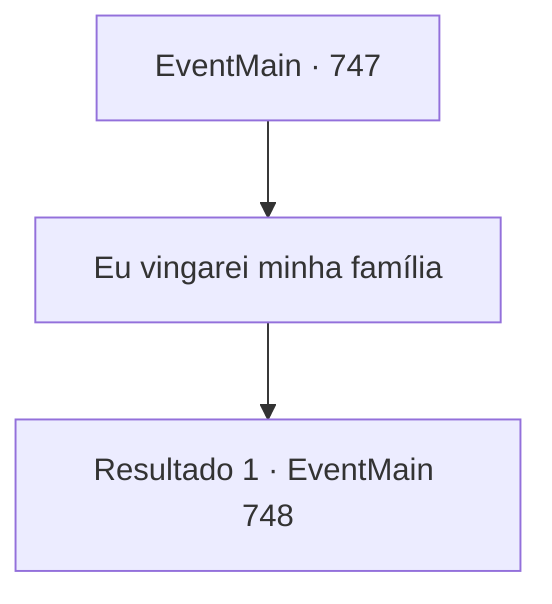

# Eventos principais · 747

[Índice da tabela](index.md) · [Índice geral](../index.md)

ID: `pt:EventMain:747` · Fonte: `EventMain4` · Versão: 1.2.47.

Mapeamento estático dos arquivos; a disponibilidade e a execução dependem do estado da run.

## Texto do evento

*Sem texto no arquivo.*

## Dados de entrada

```json
{
  "id": 747,
  "grade": 1,
  "normalGoal": "",
  "required": ""
}
```

## Mapa das escolhas



## Escolhas e resultados

### Escolha 1

Eu vingarei minha família

Requisitos e outros campos da escolha:

```json
{
  "required": ""
}
```

#### Resultado 1.1

Às suas palavras, Publius abre a boca com uma expressão surpresa. 

 "Vingança da família...? De jeito nenhum. Eu teria queimado tudo para que isso não acontecesse..."

 Você aponta sua arma para ele. Publius olha para cima com olhos vazios e levanta a cabeça como se algo lhe viesse à mente de repente. 

 "... Entendo. É assim. Foi tudo parte do plano dele..."

 Com uma voz misturada, Publius continua. 

 "Mesmo que você me mate, sua vingança não vai acabar. Porque há um objeto separado pelo qual você realmente precisa se vingar."

 Ele diz que está muito próximo de você. E que teria dito coisas doces para você. Ele diz que é o demônio, Kior. 

 "Não se deixe enganar. {1}."

 Você concorda com a cabeça para o sussurro de Kior. Então você leva a alma de Publius. Logo você ouve a voz satisfeita de Kior. 

 "Khahaha!!! Ótimo! É excelente! Bem, vou retribuir sua dedicação. Receba minha força. Vou te dar o poder que você nunca experimentou antes."

 E então, com esse poder, ele te diz para apagar tudo sobre Tere.

Continuação registrada: [Evento 748](0748.md) na mesma tabela.

```json
{
  "required": "",
  "chance": "1",
  "nextEvent": 748,
  "type": 2,
  "reward": "15_5_4"
}
```

## Referências que chegam a este evento

- [Evento 732 · escolha 1 · resultado 1](0732.md#escolha-1)
- [Evento 732 · escolha 2 · resultado 1](0732.md#escolha-2)
- [Evento 733 · escolha 1 · resultado 1](0733.md#escolha-1)
