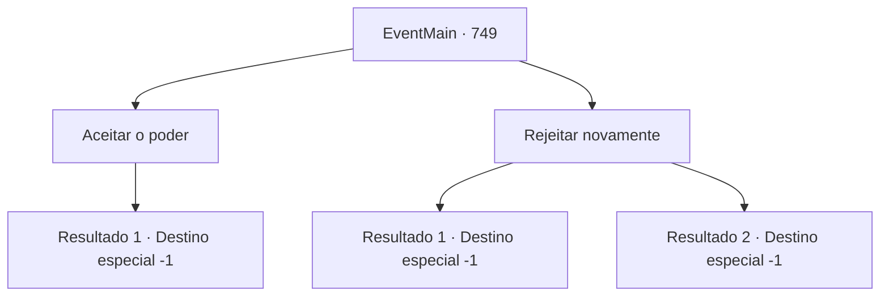

# Eventos principais · 749

[Índice da tabela](index.md) · [Índice geral](../index.md)

ID: `pt:EventMain:749` · Fonte: `EventMain4` · Versão: 1.2.47.

Mapeamento estático dos arquivos; a disponibilidade e a execução dependem do estado da run.

## Texto do evento

*Sem texto no arquivo.*

## Dados de entrada

```json
{
  "id": 749,
  "grade": 1,
  "normalGoal": "",
  "required": ""
}
```

## Mapa das escolhas



## Escolhas e resultados

### Escolha 1

Aceitar o poder

Requisitos e outros campos da escolha:

```json
{
  "required": ""
}
```

#### Resultado 1.1

Convencido pelas palavras sinceras de Kior, você aceita seu poder. Então, a força total sentida do fundo do peito se espalha por todo o corpo ao longo da espinha. Mana sombrio está correndo ao redor do seu corpo. Seus olhos estão vermelhos no vidro. 

 "Agora... A queda de Tere não está longe... Primeiro de tudo, usaremos este lugar como base... Tente reunir mais dos meus adoradores."

 Ele diz que precisamos expandir seu poder para destruir completamente Teretian. Você e os adoradores ocupam a Catedral de Yerut a pedido de Kiors.

Continuação registrada: [Destino especial `-1`](../destinos-especiais.md).

```json
{
  "required": "",
  "chance": "1",
  "nextEvent": -1,
  "type": 2,
  "reward": "15_5_5|15_5_8|15_5_14|15_5_16"
}
```

### Escolha 2

Rejeitar novamente

Requisitos e outros campos da escolha:

```json
{
  "required": ""
}
```

#### Resultado 2.1

Você rejeita as palavras sinceras de Kior novamente. Então, de repente, mana negra começa a fluir para dentro de você, Você desesperadamente a resisti. 

 "Que idiota! Você não tinha escolha desde o início. VOCÊ FAZ O QUE EU DIGO!!"

 A voz com a raiva de Kior é horrivelmente sombria e aterrorizante. E sua mana negra aperta sua mente. Mas você não desiste e se livra disso. A mana de Kior se dispersa como uma explosão, e sua voz é ouvida novamente. 

 "...Eu não entendo. Resista a mim e você morrerá em breve. Se você quer morrer assim, farei isso."

 Ao mesmo tempo em que ele diz isso, a mana de Kior que permanecia em seu corpo desaparece. E a terrível voz de Kior não é mais ouvida. Quando a mana de Kior escapa, você rapidamente fica fraco. Agora você tem a sensação de que o momento da morte está próximo. Então, os adoradores de demônios olham para você. 

 "Traição... Você é um traidor!"

 Eles correm em sua direção com os olhos virados para cima. É assim que você acaba com a morte.

Continuação registrada: [Destino especial `-1`](../destinos-especiais.md).

```json
{
  "required": "",
  "chance": "1|0_14_1",
  "nextEvent": -1,
  "type": 0,
  "reward": "15_5_13|15_5_15|15_5_16"
}
```

#### Resultado 2.2

Você rejeita as palavras sinceras de Kior novamente. Então, de repente, mana negra começa a fluir para dentro de você, Você desesperadamente a resistir. 

 "Que idiota! Você não tinha escolha desde o início. VOCÊ FAZ O QUE EU DIGO!!"

 A voz com a raiva de Kior é horrivelmente sombria e aterrorizante. E sua mana negra aperta sua mente. Mas você não pode fazer nada. Sua consciência está ficando cada vez mais escura, e até mesmo suas memórias familiares desaparecem. É assim que você acaba sendo um fantoche de Kior.

Continuação registrada: [Destino especial `-1`](../destinos-especiais.md).

```json
{
  "required": "",
  "chance": "20",
  "nextEvent": -1,
  "type": 1,
  "reward": "15_5_5|15_5_8|15_5_14|15_5_16"
}
```

## Referências que chegam a este evento

- [Evento 748 · escolha 2 · resultado 1](0748.md#escolha-2)
