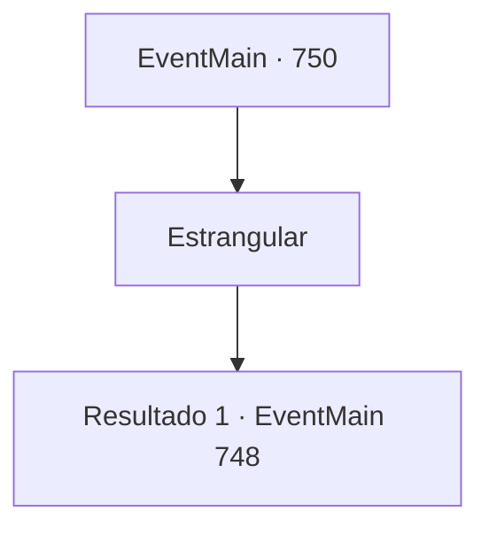

# Eventos principais · 750

[Índice da tabela](index.md) · [Índice geral](../index.md)

ID: `pt:EventMain:750` · Fonte: `EventMain4` · Versão: 1.2.47.

Mapeamento estático dos arquivos; a disponibilidade e a execução dependem do estado da run.

## Texto do evento

*Sem texto no arquivo.*

## Dados de entrada

```json
{
  "id": 750,
  "grade": 1,
  "normalGoal": "",
  "required": ""
}
```

## Mapa das escolhas



## Escolhas e resultados

### Escolha 1

Estrangular

Requisitos e outros campos da escolha:

```json
{
  "required": ""
}
```

#### Resultado 1.1

Você estrangula Publius, ignorando suas palavras. Publius luta para respirar, mas eventualmente desmaia logo em seguida. Logo você ouve a voz satisfeita de Kior. 

 "Khahaha!!! Legal! É excelente! Bem, vou te recompensar por sua dedicação. Receba minha força. Vou te dar o poder que você nunca experimentou antes."

 E então, com esse poder, Ele te diz para apagar tudo sobre Tere.

Continuação registrada: [Evento 748](0748.md) na mesma tabela.

```json
{
  "required": "",
  "chance": "1",
  "nextEvent": 748,
  "type": 2,
  "reward": ""
}
```

## Referências que chegam a este evento

- [Evento 746 · escolha 1 · resultado 1](0746.md#escolha-1)
