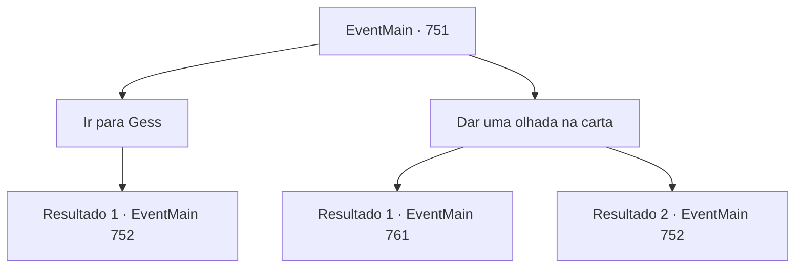

# Eventos principais · 751

[Índice da tabela](index.md) · [Índice geral](../index.md)

ID: `pt:EventMain:751` · Fonte: `EventMain4` · Versão: 1.2.47.

Mapeamento estático dos arquivos; a disponibilidade e a execução dependem do estado da run.

## Texto do evento

Você se escondeu em um beco, ouvindo a conversa de alguns homens. A ordem de captura da Igreja de Tere havia se espalhado por toda parte, e até mesmo na cidade de 'Alonzo', onde você estava, não era diferente. Os homens falavam sobre você enquanto olhavam o cartaz de procurado preso na parede.  

 "Uau, sério... esse cara realmente perdeu a cabeça! Atacar o Arcebispo da Igreja de Tere..."

 "Ele deve estar louco. Ouvi dizer que fez um pacto com um demônio."

  Eles estavam tão envolvidos na conversa que não perceberam sua presença nas proximidades. Foi nesse momento que um corvo apareceu voando, pousando em seu ombro. O corvo carregava um pequeno pedaço de papel preso no bico.  Você pegou o bilhete e deixou o corvo partir. Quando leu o conteúdo, viu que estava escrito:

  'Preciso falar com urgência. Volte para a aldeia de Kahida. Gess.'

## Dados de entrada

```json
{
  "id": 751,
  "grade": 1,
  "normalGoal": "",
  "required": "1_2_100|13_4_19"
}
```

## Mapa das escolhas



## Escolhas e resultados

### Escolha 1

Ir para Gess

Requisitos e outros campos da escolha:

```json
{
  "required": ""
}
```

#### Resultado 1.1

Você segue para a Vila de Kahida.

 A cidade de Kahida, que chegou após muito tempo, ainda está em ruínas. Todos os prédios estão cobertos de poeira e prestes a desabar, e o lixo é jogado ao vento. Mas definitivamente há uma diferença em relação ao passado. As pessoas que esperam por você lá não são adoradoras de demônios, mas a força punitiva de Teretian. Quando você pergunta sobre Gess, Valen, que estava na frente deles, grita, puxando sua espada. 

 "Você irá ao lugar dele em breve, então pergunte a ele mesmo. Ataque!"

 Com seu grito, a força punitiva corre em sua direção.

Continuação registrada: [Evento 752](0752.md) na mesma tabela.

```json
{
  "required": "",
  "chance": "1",
  "nextEvent": 752,
  "type": 2,
  "reward": "6_3_149",
  "place": 4
}
```

### Escolha 2

Dar uma olhada na carta

Requisitos e outros campos da escolha:

```json
{
  "required": "1_14_10"
}
```

#### Resultado 2.1

Você olha cuidadosamente para a nota. É estranho usar a vila abandonada de Kahida como local de encontro novamente. E então você vê letras que estavam escondidas na escrita, que foram pressionadas na caneta.

 'Há uma força punitiva em Kahida, então não venha aqui e vá para a Catedral de Yerut. Há um Publius.'

 Quando você verifica o conteúdo real da nota, você ouve a voz de Kior. 

 "Gess deve ter sido pego pela força punitiva. É admirável. Ele lhe deu essa informação valiosa antes de morrer."

 Você acena com a cabeça, rasgando a nota de Gess. Graças ao seu sacrifício, você sabe para onde ir.

Continuação registrada: [Evento 761](0761.md) na mesma tabela.

```json
{
  "required": "",
  "chance": "1|0_14_1",
  "nextEvent": 761,
  "type": 0,
  "reward": ""
}
```

#### Resultado 2.2

Você olha atentamente para a nota. É estranho usar a vila abandonada de Kahida como local de encontro novamente. Mas você não consegue encontrar nada estranho. Você segue para a Vila de Kahida.

 A cidade de Kahida, que chegou depois de muito tempo, ainda está em ruínas. Todos os prédios estão cobertos de poeira e prestes a desabar, e o lixo é jogado ao vento. Mas definitivamente há uma diferença em relação ao passado. As pessoas que esperam por você lá não são adoradoras de demônios, mas a força punitiva de Teretian. Quando você pergunta sobre Gess, Valen, que estava na frente deles, grita, puxando sua espada. 

 "Você irá ao lugar dele em breve, então pergunte a ele mesmo. Ataque!"

 Com seu grito, a força punitiva corre em sua direção.

Continuação registrada: [Evento 752](0752.md) na mesma tabela.

```json
{
  "required": "",
  "chance": "16",
  "nextEvent": 752,
  "type": 1,
  "reward": "6_3_149",
  "place": 4
}
```

## Referências que chegam a este evento

Nenhum `nextEvent` positivo da mesma tabela aponta para este nó. Isso não prova que seja inacessível: sorteio e estado de história podem selecioná-lo.

