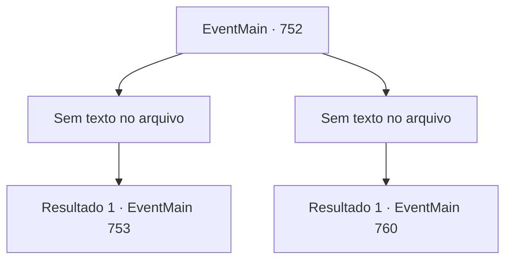

# Eventos principais · 752

[Índice da tabela](index.md) · [Índice geral](../index.md)

ID: `pt:EventMain:752` · Fonte: `EventMain4` · Versão: 1.2.47.

Mapeamento estático dos arquivos; a disponibilidade e a execução dependem do estado da run.

## Texto do evento

*Sem texto no arquivo.*

## Dados de entrada

```json
{
  "id": 752,
  "grade": 1,
  "normalGoal": "",
  "required": ""
}
```

## Mapa das escolhas



## Escolhas e resultados

### Escolha 1

*Sem texto no arquivo; o papel dessa opção depende da interface do jogo.*

Requisitos e outros campos da escolha:

```json
{
  "required": ""
}
```

#### Resultado 1.1

A lâmina da força punitiva não pode alcançar você. Todos, exceto um dos apoiadores, estão privados de suas almas. Você sobe em cima do cadáver ensanguentado. E se aproxima de Valen, a única que está respirando, e a ameaça para que ela diga tudo o que sabe. 

 "... Chega de besteiras. Me mate! Não há nada para responder a você."

 Ela não responde à sua pergunta. Ela te encara.

Continuação registrada: [Evento 753](0753.md) na mesma tabela.

```json
{
  "required": "",
  "chance": "1",
  "nextEvent": 753,
  "type": 2,
  "reward": ""
}
```

### Escolha 2

*Sem texto no arquivo; o papel dessa opção depende da interface do jogo.*

Requisitos e outros campos da escolha:

```json
{
  "required": ""
}
```

#### Resultado 2.1

Você acaba de joelhos após uma batalha feroz com força punitiva. Eles te acorrentam, te colocam em uma carroça de comboio e dirigem rapidamente. Você tenta escapar, mas logo perde a consciência com seu punho voador. |drawing_tereCathedral| Após alguns dias de viagem, você chega a um lugar esplêndido chamado Catedral de Yerut. Todo o prédio é de mármore, com uma cúpula azul no topo. Por toda a parede externa há esculturas e pinturas em mosaico em homenagem aos santos de Teretian. Logo após descer da carroça, você é capturado pela força punitiva e entra na catedral. Ao caminhar pelo chão de mármore branco, você pode ver uma figura logo em seguida. 

 "Bom dia, Arcebispo!"

 Quando os paladinos veem o homem mais velho, eles se curvam e mostram respeito. Naquela voz, você percebe que o homem mais velho é Publius.

Continuação registrada: [Evento 760](0760.md) na mesma tabela.

```json
{
  "required": "",
  "chance": "1",
  "nextEvent": 760,
  "type": 2,
  "reward": ""
}
```

## Referências que chegam a este evento

- [Evento 751 · escolha 1 · resultado 1](0751.md#escolha-1)
- [Evento 751 · escolha 2 · resultado 2](0751.md#escolha-2)
