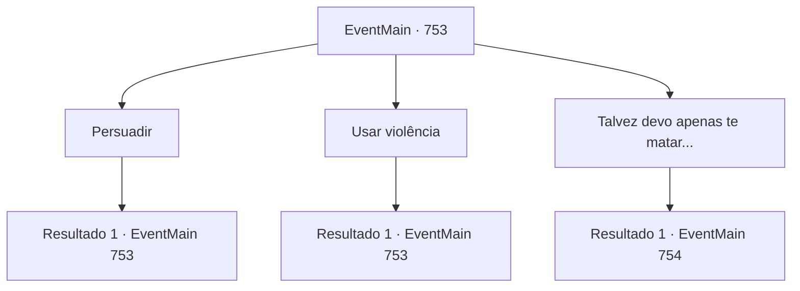

# Eventos principais · 753

[Índice da tabela](index.md) · [Índice geral](../index.md)

ID: `pt:EventMain:753` · Fonte: `EventMain4` · Versão: 1.2.47.

Mapeamento estático dos arquivos; a disponibilidade e a execução dependem do estado da run.

## Texto do evento

*Sem texto no arquivo.*

## Dados de entrada

```json
{
  "id": 753,
  "grade": 1,
  "normalGoal": "",
  "required": ""
}
```

## Mapa das escolhas



## Escolhas e resultados

### Escolha 1

Persuadir

Requisitos e outros campos da escolha:

```json
{
  "required": "5_362_0"
}
```

#### Resultado 1.1

Com palavras gentis, você pede a ela para cooperar. 

 Quanto tempo se passou? Sua boca está doendo agora. No entanto, apesar das repetidas persuasões, Valen permanece em silêncio de maneira rigorosa.

Continuação registrada: [Evento 753](0753.md) na mesma tabela.

```json
{
  "required": "",
  "chance": "1",
  "nextEvent": 753,
  "type": 2,
  "reward": "5_362_1"
}
```

### Escolha 2

Usar violência

Requisitos e outros campos da escolha:

```json
{
  "required": "5_363_0"
}
```

#### Resultado 2.1

Você amarra Valen a uma cadeira e pede cooperação com seu punho.
 'Bam, Pow--!'
 O som abafado de socos ecoa pela vila. 

 Quanto tempo se passou? Você está sem fôlego. E ainda assim ela não disse nada. Ela nem mesmo gritou. Ela te encara com olhos ardentes. 

 "...Não importa quão doce seja a conversa ou quão insulto difícil de suportar, eu não vou cooperar com você"

 Valen ri de você e cospe em você.

Continuação registrada: [Evento 753](0753.md) na mesma tabela.

```json
{
  "required": "",
  "chance": "1",
  "nextEvent": 753,
  "type": 2,
  "reward": "5_363_1"
}
```

### Escolha 3

Talvez devo apenas te matar...

Requisitos e outros campos da escolha:

```json
{
  "required": "5_362_1|5_363_1"
}
```

#### Resultado 3.1

Então, a voz de Kior é ouvida. 

 "Hahahaha! Você está passando por muita coisa. Este corpo vai ajudar. Coloque sua mão em sua cabeça."

 Você coloca sua mão na cabeça de Valen conforme Kior disse. Então, a mana negra que se estende de sua mão penetra em sua cabeça. <color=red><link=shake> 

 "A..Arggg...O que diabos você está...fazendo?! Grr..!"

</link></color> O corpo de Valen treme como se estivesse sendo eletrocutada. Ela morde os lábios como se estivesse suportando a dor, e sangue escorre de seu nariz e boca. Suas mãos também sentem inchaço e dormência nos tendões. E logo depois, a mana negra explode, e sua mão é afastada de sua cabeça. 

 "...Está arruinado. Essa coisa terrível. Resistindo ao meu controle mental... Embora você possa fazer uma pergunta simples a ela."

 Conforme Kior disse, ela perde o foco nos olhos e fica sentada como uma boneca com um fio quebrado.

Continuação registrada: [Evento 754](0754.md) na mesma tabela.

```json
{
  "required": "",
  "chance": "1",
  "nextEvent": 754,
  "type": 2,
  "reward": ""
}
```

## Referências que chegam a este evento

- [Evento 752 · escolha 1 · resultado 1](0752.md#escolha-1)
- [Evento 753 · escolha 1 · resultado 1](0753.md#escolha-1)
- [Evento 753 · escolha 2 · resultado 1](0753.md#escolha-2)
