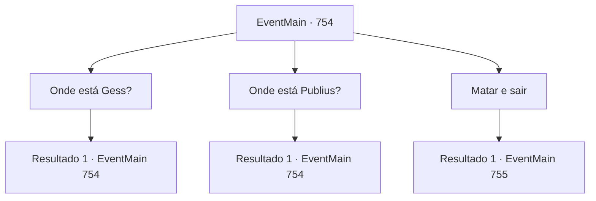

# Eventos principais · 754

[Índice da tabela](index.md) · [Índice geral](../index.md)

ID: `pt:EventMain:754` · Fonte: `EventMain4` · Versão: 1.2.47.

Mapeamento estático dos arquivos; a disponibilidade e a execução dependem do estado da run.

## Texto do evento

*Sem texto no arquivo.*

## Dados de entrada

```json
{
  "id": 754,
  "grade": 1,
  "normalGoal": "",
  "required": ""
}
```

## Mapa das escolhas



## Escolhas e resultados

### Escolha 1

Onde está Gess?

Requisitos e outros campos da escolha:

```json
{
  "required": "5_418_0"
}
```

#### Resultado 1.1

Você pergunta a ela onde Gess está. Valen hesita por um momento, então murmura lentamente a resposta. 

 "O bar... amarrado..."

 Você não ouve sua resposta. Você vai para o bar. Lá, que leva ao esconderijo subterrâneo, está Gess, que está acorrentado. Você encosta seu ouvido no peito de Gess. Mas você não consegue ouvir seu coração e só consegue sentir sua temperatura corporal fria. 

 "Há um bom item no bolso dele. Pegue-o."

 Na voz de Kior em sua cabeça, você tira o Amuleto de seus braços e o pega. Então você sai do bar e se aproxima de Valen, que está sentada em branco.

Continuação registrada: [Evento 754](0754.md) na mesma tabela.

```json
{
  "required": "",
  "chance": "1",
  "nextEvent": 754,
  "type": 2,
  "reward": "5_418_1|3_72_1"
}
```

### Escolha 2

Onde está Publius?

Requisitos e outros campos da escolha:

```json
{
  "required": "5_417_0"
}
```

#### Resultado 2.1

Quando você pergunta sobre Publius, Valen gagueja em resposta. 

 "Sim... Rut... Catedral..."

 Suas palavras lembram você da Catedral de Yerut. É um dos lugares sagrados chamados de Santuário de Teretian.

Continuação registrada: [Evento 754](0754.md) na mesma tabela.

```json
{
  "required": "",
  "chance": "1",
  "nextEvent": 754,
  "type": 2,
  "reward": "5_417_1"
}
```

### Escolha 3

Matar e sair

Requisitos e outros campos da escolha:

```json
{
  "required": "5_418_1|5_417_1"
}
```

#### Resultado 3.1

Após o interrogatório, você mata Valen e dedica sua alma a Kior. Uma sensação agradável flui para seus pulmões sempre que você dedica sua alma a Kior. E você deixa o corpo dela na vila e segue para a Catedral de Yerut. |drawing_tereCathedral| A catedral, que chegou alguns dias depois, é esplêndida. Todo o prédio é feito de mármore, com uma cúpula azul no topo. Por toda a parede externa, há esculturas e pinturas em mosaico em homenagem aos santos de Teretian. 

 "Pare!"

 Conforme você se aproxima, os paladinos que guardam a catedral bloqueiam você e empurram a espada. Eles olham para você momentaneamente e, de repente, tocam a trombeta. 

 "É o demônio! O demônio está aqui!"

 Ao grito, os paladinos da catedral se apressam para fora.

Continuação registrada: [Evento 755](0755.md) na mesma tabela.

```json
{
  "required": "",
  "chance": "1",
  "nextEvent": 755,
  "type": 2,
  "reward": "6_0_149|5_419_1",
  "place": 4
}
```

## Referências que chegam a este evento

- [Evento 753 · escolha 3 · resultado 1](0753.md#escolha-3)
- [Evento 754 · escolha 1 · resultado 1](0754.md#escolha-1)
- [Evento 754 · escolha 2 · resultado 1](0754.md#escolha-2)
